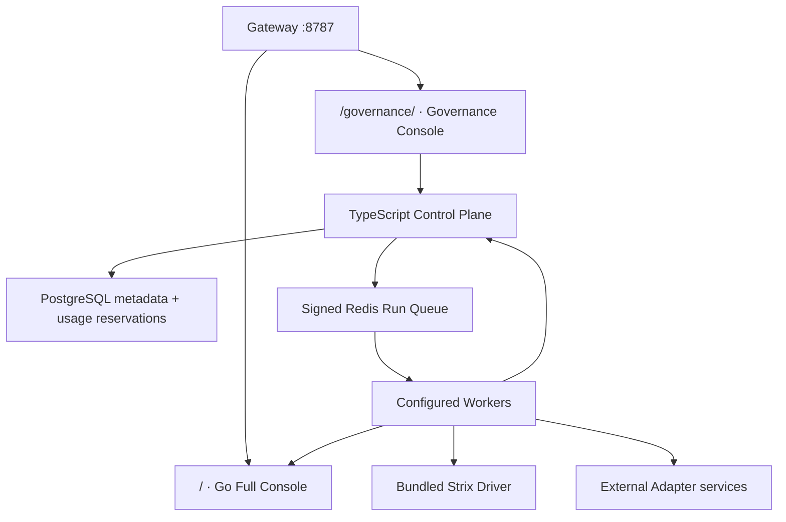

<p align="center">
  
</p>

<h1 align="center">JySecAI</h1>

<p align="center">
  <strong>Jy 技術團隊打造的 AI 原生安全驗證與多引擎治理平臺</strong><br>
  一套授權邊界、人工審批、任務生命週期、證據索引與商用計費基礎，統一協調自主滲透、LLM／Agent 紅隊、ML 魯棒性與身分安全稽核。
</p>

> [!IMPORTANT]
> JySecAI 僅限於資產所有者或已取得明確書面授權的安全測試。平臺刻意保留 HITL、Scope、RBAC 與可追溯稽核；「無痕整合」在本專案只代表一致的使用體驗，不代表隱匿行為、繞過偵測或刪除紀錄。

## 專案現況

JySecAI 由兩個後端應用組成；reference Compose 已用同源 Gateway 將它們組裝成一個產品入口：

| 產品面 | Compose 對外路徑 | 已有能力 |
|---|---|---|
| Go 完整主控臺 | `/` | 專案、對話、多 Agent、工作流、資產、漏洞、知識庫、Blackboard、攻擊鏈、HITL、RBAC、Audit、MCP、WebShell、C2 與機器人整合 |
| TypeScript 治理控制面 | `/governance/` | Run 建立／審批／取消、Scope 驗證、方案額度、事件、Finding／Artifact metadata、Redis Worker queue、Prometheus 與選配 Stripe |

`compose.jysec.yml` 會以 `Dockerfile.core` 建置 Go core，並啟動 TypeScript control-plane、PostgreSQL、Redis 與使用 `deploy/nginx.conf` 的 Nginx Gateway。Gateway 在 `http://127.0.0.1:8787` 提供：

| 路徑 | 上游／行為 |
|---|---|
| `/` | Go 完整主控臺（包含 WebSocket／SSE） |
| `/governance/` | TypeScript 治理、執行、證據索引與計費頁面 |
| `/assets/*`、`/v1/*` | TypeScript 靜態資產與 API |
| `/metrics` | TypeScript Prometheus endpoint；仍需透過 metrics token 驗證 |
| `/internal/*` | 不公開；Gateway 直接回覆 `404`，Worker 只使用私有 service address callback |

這是統一路由，不是統一身份：Go 主控臺仍使用既有 session，治理控制面仍驗證自己的 JWT／JWKS。正式單一登入仍需共同 IdP 或受控 token exchange。

## 目前確實已落地

- JySecAI 品牌已套用至新增控制面與既有 Go Web 介面。
- Fastify 控制面、PostgreSQL store、Redis Streams dispatcher、JWT／JWKS 驗證、Prometheus metrics。
- Run 建立、一次人工核准、取消、狀態轉移、冪等鍵、租戶並發與月額度檢查。
- URL、Host、Wildcard Domain、IPv4／IPv6 CIDR、期限與 operation 的 Scope 驗證。
- HMAC 簽名工作、工作時效檢查、樂觀狀態轉移，以及 Worker 外層失敗的 bounded dead-letter stream。
- Finding 正規化，以及 Artifact object key、SHA-256、media type、size 與 `encrypted=true` metadata 驗證。
- Go core 容器與同源 Nginx Gateway；Compose 會將 `/` 導向完整主控臺，將 `/governance/`、`/assets/*`、`/v1/*` 與 `/metrics` 導向治理控制面，且不公開 `/internal/*` callback。
- Strix CLI Driver；Worker image 會安裝鎖定版本，但執行仍需 LLM、Docker sandbox 與明確啟用設定。
- JySecAI／Jy Workflow HTTP Driver；Compose 已包含 Go 核心，但使用前仍須提供可被核心接受的 service token。
- 選配 Stripe Checkout、Customer Portal 與訂閱 Webhook 驗證。
- Production 組態會拒絕 memory store、development auth、預設金鑰、未保護 metrics 與非 HTTPS 公開網址。

## 尚未完成或不隨倉庫部署

- Promptfoo、PyRIT、Giskard、ART、Humanbound 與 AD Audit 目前只有統一 HTTP Adapter 契約；本倉庫未包含它們的 Adapter service 或映像。
- Artifact 本體上傳、下載、S3／MinIO、KMS 與 envelope encryption 尚未實作；目前儲存的是 metadata。
- OIDC／SAML 登入流程、SCIM、組織生命週期與兩套控制檯的單一登入尚未完成；控制面僅支援驗證既有 JWT／JWKS。
- Worker heartbeat、即時 liveness/capacity、pending-job reclaim、checkpoint/retry 與跨節點排程尚未完成。已配置 URL 只表示可嘗試連線，不等於完成 E2E 驗證。
- `paused`／`budget_paused` 已存在於狀態模型，但尚無公開 pause/resume 操作面。
- 稽核儲存天數、SSO 與 private worker 目前是 entitlement／能力旗標，尚未形成完整的儲存排程或佈建流程。
- Credits 現階段是建立 Run 時的 reservation，不是依實際 Token、GPU 或執行時間結算的用量計費。
- Reference Compose 是單節點部署範例；外部負載平衡、control-plane／Worker 多副本協調、PostgreSQL／Redis 高可用、備份還原與跨區域容錯尚未完成。
- 尚未完成授權 staging target 的全引擎端到端驗收；目前 CI 主要驗證型別、單元測試、Go 測試及容器可建置性。

## 引擎整合矩陣

| 引擎 | Repo 內實作 | 啟用條件 | 目前成熟度 |
|---|---|---|---|
| Jy Workflow Orchestrator | HTTP Driver + Go core 容器 | 配置 service token；Compose 預設使用私有 `core:8080` | 已接入部署拓撲，仍需授權環境 E2E |
| Strix | CLI Driver + Worker image | 明確啟用、LLM key、可用 Docker sandbox | Driver 已實作，需授權環境 E2E |
| Promptfoo | 通用 HTTP client | 部署相容 Adapter 並配置 URL | 僅有契約，不隨倉庫部署 |
| PyRIT | 通用 HTTP client | 部署相容 Adapter 並配置 URL | 僅有契約，不隨倉庫部署 |
| Giskard | 通用 HTTP client | 部署相容 Adapter 並配置 URL | 僅有契約，不隨倉庫部署 |
| ART | 通用 HTTP client | 部署相容 Adapter 並配置 URL／GPU | 僅有契約，不隨倉庫部署 |
| Humanbound | 通用 HTTP client | 部署相容 Adapter 並配置 URL | 選配契約，不隨倉庫部署 |
| AD Risk Audit | 通用 HTTP client | 部署隔離、預設唯讀的 Adapter | 僅有契約，不隨倉庫部署 |

> 「Adapter 契約存在」不等於該引擎已安裝或線上。Runtime catalog 會依部署設定決定是否允許選擇；現階段的 `ready` 僅表示必要設定存在，完整主動健康檢查與 Worker heartbeat 尚未完成。

## 架構



每個控制面工作只攜帶授權範圍與最小任務內容。Go 核心負責 Agent Session 與既有專案資料；控制面儲存 Run、Event、Finding 與 Artifact metadata。原始 Artifact 的加密物件儲存尚待實作，不能只靠 `encrypted=true` metadata 視為已加密落盤。

更完整設計見 [架構檔案](docs/jysec-architecture.md) 與 [Adapter 契約](docs/jysec-adapter-contract.md)。

## 本機啟動

### 完整 Go 主控臺（單獨開發）

依 [既有部署指南](docs/zh-CN/deployment.md) 配置 `config.yaml` 後啟動：

```bash
./run.sh
```

預設使用自簽 HTTPS 並監聽 `8080`。這是目前檢視專案、對話、Agent、工作流、資產與其他完整功能的入口。

### 治理控制面（單獨開發）

需求：Node.js 24+。

```bash
cd platform
cp .env.example .env
npm ci
npm run check
npm run dev
```

開啟 `http://127.0.0.1:8787`。開發模式使用記憶體儲存與 header identity；它適合 UI／API 評估，但 `MemoryRunDispatcher` 沒有背景 Worker，因此核准後的 Run 不會在此模式自行執行。Production 會拒絕這種組態。

## 統一 Compose reference

```bash
cp platform/production.env.example platform/.env.production
# 編輯所有密碼、JWT、Worker、Metrics、Stripe 與引擎設定
docker compose -f compose.jysec.yml up -d --build

# 僅在專用、隔離 Worker 主機上啟用 Strix／已配置 Adapter Worker
docker compose -f compose.jysec.yml --profile worker up -d --build worker
```

Compose 預設會啟動 PostgreSQL、Redis、Go core、治理控制面與 HTTP Gateway；開啟 `http://127.0.0.1:8787/` 可進入完整主控臺，`http://127.0.0.1:8787/governance/` 可進入治理控制檯。Worker 只會在明確指定 `--profile worker` 時啟動。外部 Adapter、S3／MinIO 物件儲存、共同 IdP、HA 與對外 TLS 終結不隨 reference Compose 部署。Gateway 預設只繫結 loopback；公開服務時必須再放到 TLS／Zero Trust 入口後方。Strix Worker 會掛載 Docker socket，請只在專用節點使用。完整邊界見 [部署與強化指南](docs/jysec-deployment.md)。

## 驗證

```bash
npm --prefix platform run check
npm --prefix platform audit --audit-level=high
npm --prefix platform run build
node --test web/static/js/*.test.cjs
go test ./...
```

GitHub Actions 會在每次 push／PR 執行控制面型別檢查、單元測試、依賴稽核、既有 Web console 測試、Go 測試與 control-plane／worker 容器建置驗證。它不代表外部 Adapter、LLM provider、Docker sandbox 或真實 target 已完成 E2E。

## 商用方式

JySecAI 已具備方案 catalog、建立 Run 時的 credits reservation、並發與引擎 entitlement，以及選配 Stripe 自助訂閱的工程基礎。儲存期限、私有 Worker 與 SSO 目前仍包含尚待實作的能力旗標與部署工作。完成營運、法律與 E2E 工作後，可採：

- 代管 SaaS：按月／年訂閱與超額 credits。
- 私有部署：年度授權、部署費、維護與 SLA。
- Sovereign Enterprise：客戶 VPC／內網、私有模型、私有 Worker、長期稽核。
- 專業服務：授權紅隊評估、規則包、整合與報告。

授權與可收費邊界請先閱讀 [COMMERCIAL.md](COMMERCIAL.md)。

## 開源來源與法律

JySecAI 目前以 Apache-2.0 的 [JySecAI](https://github.com/Ed1s0nZ/JySecAI) 為平臺基礎進行品牌與控制面擴充。Strix 以外部、可替換 Worker 方式整合，並未複製進本倉庫。Promptfoo、PyRIT、Giskard、ART、Humanbound 等由部署者依各自授權安裝。

plutoxAI 公開倉庫在分析時未提供可整合的完整原始碼與明確授權，因此 JySecAI 沒有複製其程式或素材，只採用一般性的工具目錄／工作臺產品觀念。

請保留 [Apache-2.0 LICENSE](LICENSE) 與 [NOTICE](NOTICE)。JySecAI 名稱、Jy 立體標誌與 Jy 技術團隊品牌識別不因原始碼授權而自動授權為商標使用。

## 開發者

**Jy 技術團隊** · [TIAN0517/JySecAI](https://github.com/TIAN0517/JySecAI)
