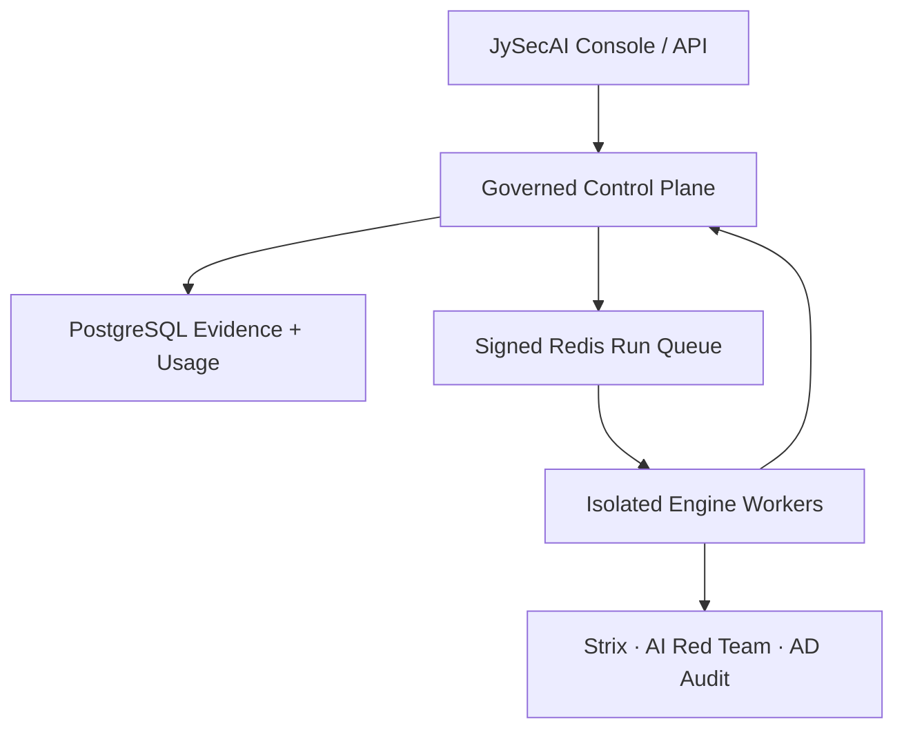

<p align="center">
  
</p>

<h1 align="center">JySecAI</h1>

<p align="center">
  <strong>Jy 技術團隊打造的 AI 原生安全驗證與多引擎治理平台</strong><br>
  一套授權邊界、人工審批、任務生命週期、證據帳本與商用計費，統一協調自主滲透、LLM／Agent 紅隊、ML 魯棒性與身分安全稽核。
</p>

> [!IMPORTANT]
> JySecAI 僅限於資產所有者或已取得明確書面授權的安全測試。平台刻意保留 HITL、Scope、RBAC 與不可抵賴稽核；「無痕整合」在本專案只代表一致的使用體驗，不代表隱匿行為、繞過偵測或刪除紀錄。

## 目前完成的核心

- JySecAI 3D 品牌、登入頁、主控台與原平台介面全面識別更新。
- TypeScript 商用控制面：Fastify、PostgreSQL、Redis Streams、JWKS／JWT、Prometheus、Stripe。
- 多租戶與方案權限：Community、Professional、Business、Enterprise Sovereign。
- 受管 Run 狀態機：建立、審批、排程、執行、暫停、預算暫停、完成、失敗與取消。
- 明確授權範圍：URL、Host、Wildcard Domain、IPv4／IPv6 CIDR、期限與操作類型。
- 企業級一致性：冪等衝突偵測、每租戶配額鎖、樂觀狀態轉移、簽名工作、過期工作拒絕、死信佇列。
- 證據資料層：正規化 Finding、信心分數、反證、修復建議、加密 Artifact metadata 與 SHA-256。
- 人工審批與 RBAC：執行者、審批者、管理者與計費管理權限分離。
- 商用付款：Stripe Checkout、Customer Portal、Webhook 簽章驗證、方案 entitlement。
- 生產守門：禁止 production 使用 memory store、dev auth、共用密鑰、公開 metrics 或 HTTP 公開網址。

## 引擎整合矩陣

| 引擎 | JySecAI 接入方式 | 狀態 | 用途 |
|---|---|---:|---|
| Jy Workflow Orchestrator | 內建平台核心／HTTP adapter | Core | 專案、工作流、工具、黑板、HITL、攻擊鏈 |
| Strix | 受限 CLI Worker | Core | 沙箱化 Web／API／原始碼自主驗證 |
| Promptfoo | 統一 Worker adapter contract | Core | LLM、Prompt、RAG 安全回歸 |
| PyRIT | 統一 Worker adapter contract | Core | 多輪與多模態 AI 紅隊 campaign |
| Giskard | 統一 Worker adapter contract | Core | Agent／RAG 品質與安全評估 |
| ART | 統一 Worker adapter contract | Core | 對抗式 ML 魯棒性測試 |
| Humanbound | 統一 Worker adapter contract | Optional | Agent 工具邊界與間接注入測試 |
| AD Risk Audit | 統一 Worker adapter contract，預設唯讀 | Core | SPN、Kerberos 加密、Pre-auth 與事件風險分析 |

除內建核心外，各工具仍維持自己的執行環境與版本生命週期；JySecAI 統一的是授權、排程、狀態、證據與計費契約。這可避免直接拼接多個專案後產生相依衝突，也能讓 GPU、Windows AD 與隔離滲透 Worker 分開擴展。

## 架構



每個工作只攜帶不可變授權範圍與最小任務內容。Session 保存當前推理，Project Findings 保存長期事實，原始證據留在加密物件儲存並以 SHA-256 連結。

更完整設計見 [架構文件](docs/jysec-architecture.md) 與 [Adapter 契約](docs/jysec-adapter-contract.md)。

## 本機啟動控制面

需求：Node.js 24+。

```bash
cd platform
cp .env.example .env
npm ci
npm run check
npm run dev
```

開啟 `http://127.0.0.1:8787`。開發模式使用記憶體儲存與受限的 header identity；任何 production 組態都會拒絕這種模式。

## 生產部署

```bash
cp platform/production.env.example platform/.env.production
# 編輯所有密碼、JWT、Worker、Metrics、Stripe 與引擎設定
docker compose -f compose.jysec.yml up -d --build

# 僅在專用、隔離 Worker 主機上啟用自主測試 Worker
docker compose -f compose.jysec.yml --profile worker up -d --build worker
```

控制面預設只綁定 `127.0.0.1:8787`，應置於 TLS reverse proxy／Zero Trust Access 後。Strix Worker 需要 Docker sandbox；範例 compose 的 Worker profile 會掛載 Docker socket，請只在專用節點使用。完整程序見 [部署與強化指南](docs/jysec-deployment.md)。

## 驗證

```bash
npm --prefix platform run check
npm --prefix platform audit --audit-level=high
npm --prefix platform run build
node --test web/static/js/*.test.cjs
go test ./...
```

GitHub Actions 會在每次 push／PR 執行控制面型別檢查、單元測試、依賴稽核、前端契約測試、Go 測試與 control-plane／worker 容器建置驗證。

## 商用方式

JySecAI 已具備按月 credits、並發數、引擎 entitlement、稽核保存期限、私有 Worker、SSO 能力旗標與 Stripe 自助訂閱。可採：

- 代管 SaaS：按月／年訂閱與超額 credits。
- 私有部署：年度授權、部署費、維護與 SLA。
- Sovereign Enterprise：客戶 VPC／內網、私有模型、私有 Worker、長期稽核。
- 專業服務：授權紅隊評估、規則包、整合與報告。

授權與可收費邊界請先閱讀 [COMMERCIAL.md](COMMERCIAL.md)。

## 開源來源與法律

JySecAI 目前以 Apache-2.0 的 [CyberStrikeAI](https://github.com/Ed1s0nZ/CyberStrikeAI) 為平台基礎進行品牌與控制面擴充。Strix 以外部、可替換 Worker 方式整合，並未複製進本倉庫。Promptfoo、PyRIT、Giskard、ART、Humanbound 等由部署者依各自授權安裝。

plutoxAI 公開倉庫在分析時未提供可整合的完整原始碼與明確授權，因此 JySecAI 沒有複製其程式或素材，只採用一般性的工具目錄／工作台產品觀念。

請保留 [Apache-2.0 LICENSE](LICENSE) 與 [NOTICE](NOTICE)。JySecAI 名稱、Jy 立體標誌與 Jy 技術團隊品牌識別不因原始碼授權而自動授權為商標使用。

## 開發者

**Jy 技術團隊** · [TIAN0517/JySecAI](https://github.com/TIAN0517/JySecAI)
