# CLAUDE.md

This file provides guidance to Claude Code (claude.ai/code) when working with code in this repository.

## 项目概述

Dragon-V Triple Bot是一个企业级渗透测试框架，专为亚洲地区（越南、中国、泰国）的物流、快递、邮政系统设计。系统采用三层统一架构，通过Telegram Bot提供AI驱动的自动化漏洞扫描服务。

### 变更记录 (Changelog)
- **v3.2.0 (2025-10-29)**: 重大架构更新，完善企业级渗透测试框架
  - 新增68个渗透测试工具和漏洞利用模块
  - 完善的三层微服务架构和896个安全测试资源
  - 零日漏洞发现引擎和高级验证器
  - 统一配置管理和Docker部署支持
  - 清理冗余启动脚本，优化系统性能

- **v3.1.0 (2025-10-28)**: MCP服务器深度集成和AI功能增强
  - 集成21个MCP安全测试模块
  - 新增量子神经网络引擎和威胁情报网络
  - 完善WAF绕过技术和载荷生成器
  - 增强数据提取工具和漏洞验证器

- **v3.0.0 (2025-10-26)**: 企业级框架基础版本
  - 核心三层架构设计
  - Telegram Bot系统集成
  - 3个专用数据库架构
  - 基础漏洞扫描和WAF绕过功能

## 架构总览

### 系统架构图 (v3.2.0)

```mermaid
graph TD
    A["🐉 Dragon-V Triple Bot v3.2.0<br/>企业级渗透测试框架"] --> B["📱 用户交互层"];
    A --> C["🔧 业务逻辑层"];
    A --> D["⚙️ 核心引擎层"];
    A --> E["💾 数据存储层"];
    A --> F["🛡️ 安全资源库"];
    A --> G["🔌 工具集成层"];

    B --> B1["🤖 Telegram Bot系统<br/>3个专用Bot实例"];
    B --> B2["👥 权限管理<br/>admin/user/guest三级权限"];
    B --> B3["🎨 交互界面<br/>菜单系统/实时通知"];

    C --> C1["🎯 统一管理器<br/>任务调度/负载均衡"];
    C --> C2["⚡ 功能模块<br/>企业级管理/专业扫描"];
    C --> C3["📊 报告系统<br/>HTML/JSON/Markdown多格式"];
    C --> C4["🔄 任务队列<br/>异步处理/故障转移"];

    D --> D1["🐉 Dragon-V Hunter<br/>越南化渗透引擎"];
    D --> D2["💥 漏洞利用引擎<br/>68个利用模块"];
    D --> D3["🛡️ WAF绕过工具<br/>高级绕过技术"];
    D --> D4["🔌 MCP服务器<br/>21个安全测试模块"];
    D --> D5["🧠 零日发现引擎<br/>AI驱动漏洞挖掘"];

    E --> E1["📊 任务数据库<br/>dragon_triple_bot_unified.db"];
    E --> E2["👤 用户数据库<br/>dragon_triple_telegram_bot.db"];
    E --> E3["⚙️ 功能数据库<br/>dragon_triple_functional.db"];
    E --> E4["🔍 零日数据库<br/>zero_day_*.db (2个)"];

    F --> F1["📚 漏洞库<br/>414个CVE定义 (中英文)"];
    F --> F2["🔎 指纹库<br/>42种应用指纹"];
    F --> F3["🧪 评估集<br/>5个AI安全数据集"];
    F --> F4["💣 载荷库<br/>多类型攻击载荷"];

    G --> G1["🔍 Nuclei<br/>漏洞扫描引擎"];
    G --> G2["🗺️ Nmap<br/>端口扫描服务"];
    G --> G3["💉 sqlmap<br/>SQL注入工具"];
    G --> G4["🎭 Metasploit<br/>渗透测试框架"];
    G --> G5["🕵️ weevely3<br/>Web shell管理"];
    G --> G6["🔥 wafw00f<br/>WAF识别工具"];

    click D1 "./dragon_v_hunter/CLAUDE.md" "查看 Dragon-V Hunter 详细文档"
    click D4 "./mcp/CLAUDE.md" "查看 MCP 服务器模块文档"
    click F1 "./vuln/CLAUDE.md" "查看漏洞数据库文档"
    click F2 "./fingerprints/CLAUDE.md" "查看指纹库文档"
    click G1 "https://docs.projectdiscovery.io/tools/nuclei/" "Nuclei 官方文档"
```



### 核心特性 (v3.2.0)
- **🎯 智能目标识别**: 支持42种应用指纹自动识别
- **🧠 AI驱动扫描**: 零日漏洞发现和智能攻击链生成
- **🛡️ 高级绕过技术**: 支持阿里云、Cloudflare等主流WAF
- **📊 实时报告系统**: 多格式报告生成和实时进度监控
- **🔌 工具生态集成**: 6大专业安全工具深度集成
- **🌏 亚洲地区定制**: 针对越南、中国、泰国的专门优化
- **⚡ 高性能架构**: 异步处理和智能负载均衡

### 主要系统组件
- **Dragon-V Hunter** - 核心渗透测试引擎 (`dragon_v_hunter/`)
- **Telegram Bot系统** - 用户交互和任务管理接口
- **漏洞数据库** - CVE漏洞定义和指纹识别库
- **MCP服务器** - 渗透测试工具集成 (`mcp/`)
- **指纹识别库** - 应用指纹库 (`fingerprints/`)
- **WAF绕过工具** - 高级绕过技术集成

### 核心架构模式

#### 三层设计模式
```
用户层           功能层           执行层
📱 Telegram Bot  🔧 功能模块      🐉 Dragon-V Hunter
                📊 统一管理器     🎯 目标系统
                🚀 任务调度器     💾 数据库操作
```

#### 微服务架构
- **Bot实例管理**: 多个Telegram Bot实例并行运行
- **任务队列系统**: 异步任务处理和负载均衡
- **数据库分离**: 3个专用SQLite数据库，职责清晰
- **模块化设计**: 独立的功能模块，易于扩展和维护

## 核心模块详解 (v3.2.0)

### 🎯 统一管理系统
| 模块路径 | 版本 | 职责描述 | 核心功能 | 技术栈 |
|---------|------|---------|---------|--------|
| `dragon_triple_bot_unified_manager.py` | v3.2.0 | 统一管理器 | Bot实例管理、智能任务调度、负载均衡、故障转移 | Python + AsyncIO + SQLite |
| `dragon_triple_bot_functional_module.py` | v3.2.0 | 功能模块中心 | 企业级管理、专业扫描、安全工具集成、报告生成 | Python + Telegram API |
| `dragon_triple_telegram_bot.py` | v3.2.0 | Telegram接口 | 用户交互、三级权限控制、智能菜单系统、实时通知 | python-telegram-bot + Rich |

### 🐉 核心引擎系统
| 模块路径 | 版本 | 职责描述 | 核心功能 | 技术栈 |
|---------|------|---------|---------|--------|
| `dragon_v_hunter/` | v3.2.0 | 越南化渗透引擎 | 亚洲地区定制渗透、业务逻辑漏洞、本地化漏洞库 | Python + asyncio + 指纹识别 |
| `exploitation_module.py` | v3.2.0 | 漏洞利用引擎 | 68个利用模块、SQL注入、XSS、文件上传、RCE | requests + asyncio + 载荷生成 |
| `waf_bypass_advanced.py` | v3.2.0 | 高级WAF绕过 | 多编码绕过、混淆技术、主流WAF策略、智能检测 | requests + 编码技术 + AI辅助 |
| `mcp_penetration_server.py` | v3.2.0 | MCP服务器 | 21个安全测试模块、工具集成、实时载荷生成 | Python + subprocess + 安全工具链 |

### 🧠 AI与零日发现
| 模块路径 | 版本 | 职责描述 | 核心功能 | 技术栈 |
|---------|------|---------|---------|--------|
| `ZERO_DAY_VULNERABILITY_DISCOVERY_ENGINE.py` | v3.2.0 | 零日发现引擎 | AI驱动漏洞挖掘、智能模式识别、预测分析 | scikit-learn + Numpy + Pandas |
| `QUANTUM_NEURAL_NETWORK_ENGINE.py` | v3.2.0 | 量子神经网络 | 高级威胁检测、复杂攻击模式识别、深度学习 | TensorFlow + Quantum Computing |
| `ADVANCED_ZERO_DAY_EXPLOIT_VALIDATOR.py` | v3.2.0 | 零日验证器 | 漏洞真实性验证、PoC生成、风险评估 | 自定义验证框架 |

### 🔍 专业工具集成
| 模块路径 | 版本 | 职责描述 | 核心功能 | 集成工具 |
|---------|------|---------|---------|--------|
| `advanced_loan_penetration.py` | v3.2.0 | 信贷系统渗透 | 越南/泰国信贷系统、业务逻辑漏洞、数据提取 | 自定义框架 |
| `thai_loan_penetration.py` | v3.2.0 | 泰国信贷渗透 | 泰国银行系统、语言本地化、文化适配 | 本地化工具 |
| `multidimensional_attack_matrix.py` | v3.2.0 | 攻击矩阵 | ATT&CK框架映射、攻击链生成、路径规划 | MITRE ATT&CK |
| `darkweb_intelligence_network.py` | v3.2.0 | 暗网情报 | 威胁情报收集、暗网监控、预警系统 | Tor + Intelligence API |

### 💼 企业级工具
| 模块路径 | 版本 | 职责描述 | 核心功能 | 应用场景 |
|---------|------|---------|---------|--------|
| `PEACOOP_ADVANCED_EXPLOITATION.py` | v3.2.0 | PEACOOP利用 | Peacock供应链漏洞、企业系统渗透 | 供应链安全 |
| `MULA_X_ADVANCED_EXPLOITATION.py` | v3.2.0 | MULA-X利用 | 金融系统漏洞、交易安全、数据保护 | 金融安全 |
| `HANSHIN_XSS_EXPLOITATION.py` | v3.2.0 | 韩新XSS利用 | 韩新集团系统、XSS攻击链、客户端安全 | 企业Web安全 |
| `REAL_DATA_EXTRACTION_TOOL.py` | v3.2.0 | 数据提取工具 | 结构化数据提取、数据库渗透、文件恢复 | 数据恢复取证 |

### 🔧 系统管理工具
| 模块路径 | 版本 | 职责描述 | 核心功能 | 管理范围 |
|---------|------|---------|---------|--------|
| `🚀_一键启动.py` | v3.2.0 | 系统启动器 | 一键启动所有组件、环境检查、健康监控 | 系统部署 |
| `🔧_系统工具集.py` | v3.2.0 | 系统工具集 | 系统维护、性能优化、日志管理、备份恢复 | 系统维护 |
| `🔍_故障诊断.py` | v3.2.0 | 故障诊断 | 问题检测、错误分析、自动修复、性能监控 | 故障处理 |
| `integrated_system_launcher.py` | v3.2.0 | 集成启动器 | 分布式部署、服务编排、监控告警 | 生产部署 |

## 运行与开发

### 🚀 快速启动指南 (v3.2.0)

#### 一键启动（推荐）
```bash
# 完整系统启动（推荐生产环境）
python 🚀_一键启动.py

# 集成系统启动器（推荐开发环境）
python integrated_system_launcher.py
```

#### 分层启动模式
```bash
# 1. 启动统一管理器
python dragon_triple_bot_unified_manager.py

# 2. 启动Dragon-V Hunter核心引擎
python dragon_v_hunter/main.py

# 3. 启动MCP渗透测试服务器
python mcp_penetration_server.py

# 4. 启动AI零日发现引擎
python ZERO_DAY_VULNERABILITY_DISCOVERY_ENGINE.py
```

#### 容器化部署
```bash
# Docker Compose 部署（生产环境）
docker-compose up -d

# Docker Compose 开发环境
docker-compose -f docker-compose.dev.yml up -d
```

### 🔧 开发与调试工具

#### 系统维护工具
```bash
# 系统健康检查
python CHECK_SYSTEM.py

# 故障诊断与自动修复
python 🔍_故障诊断.py

# 系统工具集（性能优化、日志管理等）
python 🔧_系统工具集.py
```

#### 组件测试
```bash
# 测试单个bot实例
python bot_1_working.py

# MCP功能测试
python test_mcp_functions.py
python simple_mcp_test.py

# 零日引擎测试
python real_vulnerability_validator.py
```

### 🎯 专业渗透测试工具

#### 地区化渗透工具
```bash
# 越南信贷系统渗透测试
python advanced_loan_penetration.py

# 泰国信贷系统渗透测试
python thai_loan_penetration.py

# 泰国信贷利用系统
python thai_loan_exploitation_system.py
```

#### 高级漏洞利用
```bash
# 零日漏洞验证
python ADVANCED_ZERO_DAY_EXPLOIT_VALIDATOR.py

# 多维攻击矩阵
python multidimensional_attack_matrix.py

# 企业级漏洞利用
python PEACOOP_ADVANCED_EXPLOITATION.py
python MULA_X_ADVANCED_EXPLOITATION.py
python HANSHIN_XSS_EXPLOITATION.py
```

#### WAF绕过与载荷生成
```bash
# 高级WAF绕过
python waf_bypass_advanced.py

# 认证绕过利用
python auth_bypass_exploit.py

# 载荷连接器
python MULA_X_ANTSWORD_CONNECTOR.py
python MULA_X_SIMPLE_CONNECTOR.py
```

### 📊 数据提取与分析工具

#### 智能数据提取
```bash
# 实时数据提取工具
python REAL_DATA_EXTRACTION_TOOL.py

# API数据提取
python extract_api_data.py

# 信贷数据提取
python loan_data_extractor.py

# 直接数据提取
python direct_data_extractor.py
python final_data_extractor.py
```

#### 情报与分析
```bash
# 暗网情报网络
python darkweb_intelligence_network.py

# 量子神经网络分析
python quantum_neural_network_engine.py

# 搜索菜单系统
python search_menu.py
```

### 🔌 MCP服务器与工具集成

#### MCP服务器管理
```bash
# 启动MCP渗透测试服务器
python mcp_penetration_server.py

# MCP集成工具
python mcp_integration.py

# MCP工具菜单
python mcp_tools_menu.py

# 启动MCP服务器
python start_mcp_server.py
```

#### 安全工具集成
```bash
# 漏洞数据库查询
python mcp_exploit_database.py

# 载荷数据库管理
python mcp_payloads_database.py

# 渗透集成模块
python penetration_integration_module.py
```

## 测试策略

### 测试框架
- **单元测试**: 每个模块都有对应的测试脚本
- **集成测试**: 通过`simple_test.py`进行系统级测试
- **渗透测试**: 针对真实目标的授权测试
- **性能测试**: 内存和并发限制测试

### 测试环境
- **Docker容器**: 独立的测试环境
- **模拟目标**: testphp.vulnweb.com等合法测试站点
- **本地测试**: XSS测试平台等本地环境

### 数据库测试
```python
# 检查数据库状态
import sqlite3

def check_database_status():
    databases = [
        'dragon_triple_bot_unified.db',
        'dragon_triple_telegram_bot.db',
        'dragon_triple_functional.db'
    ]

    for db_path in databases:
        conn = sqlite3.connect(db_path)
        cursor = conn.cursor()
        cursor.execute("SELECT name FROM sqlite_master WHERE type='table'")
        tables = cursor.fetchall()
        print(f"{db_path}: {len(tables)} 个表")
        conn.close()
```

## 编码规范

### 代码风格
- **Python 3.11+**: 使用现代Python特性
- **异步编程**: 优先使用async/await模式
- **类型注解**: 使用typing模块进行类型提示
- **文档字符串**: 详细的函数和类说明

### 错误处理
```python
# 标准异常处理模式
try:
    result = await some_async_operation()
except SpecificException as e:
    logger.error(f"操作失败: {e}")
    raise
except Exception as e:
    logger.error(f"未知错误: {e}")
    return None
```

### 日志规范
```python
import logging

# 配置统一日志格式
logging.basicConfig(
    level=logging.INFO,
    format='%(asctime)s - %(name)s - %(levelname)s - %(message)s',
    handlers=[
        logging.FileHandler('dragon_v_system.log', encoding='utf-8'),
        logging.StreamHandler()
    ]
)
```

### 数据库操作规范
```python
# 使用参数化查询防止SQL注入
def get_user_by_id(user_id: int):
    conn = sqlite3.connect('dragon_triple_telegram_bot.db')
    cursor = conn.cursor()
    cursor.execute("SELECT * FROM users WHERE user_id = ?", (user_id,))
    result = cursor.fetchone()
    conn.close()
    return result
```

## AI使用指引

### MCP服务器集成
- **漏洞匹配**: AI辅助的CVE匹配和优先级排序
- **载荷生成**: 基于目标特征的智能载荷生成
- **报告分析**: AI驱动的漏洞影响评估

### 评估数据集使用
```python
# 使用AI安全评估数据集
from eval.jailbreak_testing import JailbreakTester

tester = JailbreakTester()
results = tester.test_model(model_api, prompts)
```

### 智能化功能
- **目标识别**: 自动识别Web应用技术栈
- **漏洞预测**: 基于历史数据预测潜在漏洞
- **攻击链生成**: AI辅助的渗透测试路径规划

## 核心工作流程

### 系统启动流程
1. **环境检查** → 运行 `CHECK_SYSTEM.py` 验证依赖
2. **配置加载** → 读取 `config_unified.yaml` 和相关配置
3. **数据库初始化** → 创建3个SQLite数据库连接
4. **MCP服务器启动** → 初始化渗透测试服务器
5. **Bot实例启动** → 启动多个Telegram Bot实例
6. **健康检查** → 验证所有组件正常运行

### 任务执行流程
1. **用户输入** → Telegram Bot接收命令
2. **权限验证** → 检查用户角色和权限（admin/user）
3. **任务创建** → 创建任务记录并分配ID
4. **负载均衡** → 选择最佳bot实例
5. **任务执行** → 对应功能模块处理
6. **进度监控** → 实时更新任务状态
7. **结果返回** → 生成并发送报告

### 漏洞扫描流程
1. **目标识别** → 通过fingerprints/目录下的指纹库确定技术栈
2. **漏洞匹配** → 查询vuln/和vuln_en/目录匹配已知CVE
3. **载荷生成** → 通过MCP服务器生成针对性载荷
4. **WAF绕过** → 应用waf_bypass_advanced.py中的技术
5. **漏洞验证** → 验证漏洞存在性和可利用性
6. **报告生成** → 生成HTML/JSON/Markdown格式报告

## 数据库架构

### 三个专用数据库
1. **dragon_triple_bot_unified.db** - 主任务数据库
   - `tasks` - 任务记录
   - `bot_instances` - Bot实例状态
   - `system_logs` - 系统日志

2. **dragon_triple_telegram_bot.db** - Telegram用户数据
   - `users` - 用户信息和权限
   - `user_sessions` - 用户会话
   - `message_history` - 消息历史

3. **dragon_triple_functional.db** - 功能配置数据
   - `scan_configs` - 扫描配置
   - `exploit_results` - 漏洞利用结果
   - `reports` - 生成的报告

### 安全资源库结构
- **vuln/** - 中文版本漏洞定义（414个CVE）
- **vuln_en/** - 英文版本漏洞定义（414个CVE）
- **fingerprints/** - 应用指纹识别库，支持42种应用类型
- **mcp/** - MCP服务器集成，21个安全测试模块
- **eval/** - AI安全评估数据集，5个专业数据集

#### 主要漏洞类型
- **AI应用漏洞** - Chuanhugpt (CVE-2024-10707等)、ComfyUI、AnythingLLM
- **数据库漏洞** - ClickHouse、MySQL、PostgreSQL相关CVE
- **Web框架漏洞** - FastAPI、Django、Flask等
- **MCP相关漏洞** - Model Context Protocol安全研究

#### 评估数据集类型
- **越狱测试** - ChatGPT-Jailbreak-Prompts、JailbreakPrompts-Tiny
- **安全底线** - HarmfulEvalBenchmark、JADE-db-v3.0
- **综合评估** - JailBench-Tiny中文越狱数据集

## Dragon-V Hunter 详细架构

### 核心组件
- **越南化指纹识别** (`dragon_v_hunter/core/vietnamese_fingerprinter.py`)
- **攻击链生成** (`dragon_v_hunter/core/attack_chainer.py`)
- **业务逻辑渗透** (`dragon_v_hunter/business_logic_pentester.py`)

### 目标应用类型
- **物流系统**：越南邮政、快递、订单管理系统
- **AI应用**：Chuanhugpt、ComfyUI、AnythingLLM、Dify
- **数据库**：ClickHouse、MySQL、PostgreSQL
- **Web应用**：FastAPI、Django、Flask框架

## 🛠️ 技术栈架构 (v3.2.0)

### 🔧 核心后端技术
| 技术栈 | 版本 | 用途 | 特性 |
|--------|------|------|------|
| **Python** | 3.11+ | 主要编程语言 | 现代特性、类型注解、异步支持 |
| **AsyncIO** | 内置 | 异步编程框架 | 高并发、事件循环、协程支持 |
| **SQLite** | 3.41+ | 轻量级数据库 | ACID事务、3个专用数据库 |
| **Telegram Bot API** | 6.7+ | 用户交互界面 | Rich UI、实时通知、菜单系统 |
| **MCP Protocol** | 1.0+ | 工具集成标准 | 安全工具链、统一接口 |

### 🧠 AI与机器学习技术
| 技术栈 | 版本 | 用途 | 应用场景 |
|--------|------|------|----------|
| **scikit-learn** | 1.3+ | 机器学习框架 | 漏洞预测、模式识别 |
| **TensorFlow** | 2.13+ | 深度学习框架 | 量子神经网络、威胁检测 |
| **NumPy** | 1.24+ | 数值计算库 | 数据处理、矩阵运算 |
| **Pandas** | 2.0+ | 数据分析库 | 漏洞数据分析、报告生成 |
| **NLTK/spaCy** | 3.8+ | 自然语言处理 | 威胁情报分析、文本挖掘 |

### 🔌 安全工具集成生态
| 工具名称 | 版本 | 类型 | 集成方式 | 主要功能 |
|---------|------|------|----------|----------|
| **Nuclei** | 3.0+ | 漏洞扫描 | subprocess调用 | 模板化漏洞检测 |
| **Nmap** | 7.94+ | 端口扫描 | XML解析 | 服务识别、端口探测 |
| **sqlmap** | 1.8+ | SQL注入 | API调用 | 自动化SQL注入检测 |
| **Metasploit** | 6.4+ | 渗透框架 | RPC接口 | 漏洞利用、后渗透 |
| **wafw00f** | 2.2+ | WAF识别 | 正则匹配 | WAF类型识别 |
| **weevely3** | 4.5+ | Web Shell | 加密通信 | 文件管理、系统控制 |

### 🎨 前端与可视化技术
| 技术 | 版本 | 用途 | 特性 |
|------|------|------|------|
| **Rich Console** | 13.0+ | 终端美化 | 表格、进度条、语法高亮 |
| **Jinja2** | 3.1+ | 模板引擎 | HTML报告生成 |
| **Plotly** | 5.15+ | 数据可视化 | 交互式图表、仪表板 |
| **Markdown** | 3.5+ | 文档格式 | 技术文档、报告生成 |
| **JSON/YAML** | 标准 | 数据格式 | 配置文件、数据交换 |

### 📊 数据库架构与存储
| 数据库 | 用途 | 表结构 | 特性 |
|--------|------|--------|------|
| **dragon_triple_bot_unified.db** | 主任务数据库 | tasks, bot_instances, system_logs | 任务管理、状态跟踪 |
| **dragon_triple_telegram_bot.db** | 用户数据库 | users, user_sessions, message_history | 用户管理、权限控制 |
| **dragon_triple_functional.db** | 功能数据库 | scan_configs, exploit_results, reports | 配置存储、结果管理 |
| **zero_day_vulnerabilities.db** | 零日数据库 | vulnerabilities, exploits, payloads | 漏洞发现、PoC管理 |

### 🌐 网络与通信技术
| 技术 | 版本 | 用途 | 协议支持 |
|------|------|------|----------|
| **aiohttp** | 3.8+ | 异步HTTP客户端 | HTTP/1.1, HTTP/2, WebSocket |
| **requests** | 2.31+ | HTTP请求库 | 代理支持、会话管理 |
| **websockets** | 11.0+ | WebSocket通信 | 实时通信、双向数据流 |
| **paramiko** | 3.2+ | SSH客户端 | 远程命令执行、文件传输 |
| **dnspython** | 2.4+ | DNS解析 | 域名查询、记录类型 |

### 🔐 安全与加密技术
| 技术 | 版本 | 用途 | 算法支持 |
|------|------|------|----------|
| **cryptography** | 41.0+ | 加密库 | AES, RSA, ECDSA, SHA256 |
| **PyCryptodome** | 3.18+ | 密码学工具 | 对称加密、哈希函数 |
| **hashlib** | 内置 | 哈希函数 | MD5, SHA1, SHA256, SHA512 |
| **base64** | 内置 | 编码解码 | Base64, Base32, Hex |
| **urllib3** | 2.0+ | URL处理 | 编码、解析、安全 |

### 📈 性能优化技术
| 技术 | 版本 | 用途 | 优化效果 |
|------|------|------|----------|
| **uvloop** | 0.18+ | 事件循环 | 性能提升2-4倍 |
| **orjson** | 3.9+ | JSON序列化 | 快速JSON处理 |
| **lru_cache** | 内置 | 缓存机制 | 内存优化、重复查询 |
| **threading** | 内置 | 多线程 | 并发处理、任务并行 |
| **multiprocessing** | 内置 | 多进程 | CPU密集型任务优化 |

### 🚀 部署与容器化技术
| 技术 | 版本 | 用途 | 特性 |
|------|------|------|------|
| **Docker** | 24.0+ | 容器化 | 环境隔离、快速部署 |
| **Docker Compose** | 2.20+ | 容器编排 | 多服务管理、网络配置 |
| **systemd** | 254+ | 服务管理 | 自动启动、进程监控 |
| **nginx** | 1.24+ | 反向代理 | 负载均衡、SSL终端 |
| **supervisor** | 4.2+ | 进程管理 | 进程监控、自动重启 |

### 📚 开发与调试工具
| 工具 | 版本 | 用途 | 特性 |
|------|------|------|------|
| **pytest** | 7.4+ | 单元测试 | 参数化测试、覆盖率 |
| **black** | 23.0+ | 代码格式化 | PEP8标准、自动格式化 |
| **flake8** | 6.0+ | 代码检查 | 语法检查、代码质量 |
| **mypy** | 1.5+ | 类型检查 | 静态类型分析 |
| **pre-commit** | 3.4+ | Git钩子 | 提交前检查、自动化 |

## 重要注意事项

### 安全合规
- **仅授权测试**：只对有明确授权的系统进行测试
- **法律合规**：确保遵守当地网络安全法律法规
- **数据保护**：处理敏感数据时注意隐私保护

### 性能优化（基于config_unified.yaml）
- **并发控制**：最多3个并发任务
- **资源管理**：256MB内存限制，定期清理
- **缓存机制**：1800秒TTL缓存提升响应速度
- **请求限制**：每分钟最多60个请求
- **AI功能**：默认禁用外部API调用，使用本地模式节省资源

### MCP服务器集成
- **漏洞数据库**：896个安全测试资源（414个CVE + 42个指纹 + 21个MCP模块）
- **渗透测试工具**：集成sqlmap、Nuclei等专业工具
- **实时载荷生成**：支持reverse_shell、web_shell、sql_injection、xss等类型
- **端口和漏洞扫描**：自动化目标识别和漏洞匹配

## 故障排除

### 常见问题及解决方案

#### 1. Telegram Bot无响应
```bash
# 检查token有效性
curl -X POST "https://api.telegram.org/bot<TOKEN>/getMe"

# 检查网络连接
python -c "import requests; print(requests.get('https://api.telegram.org').status_code)"
```

#### 2. 数据库锁定问题
```python
# 增加连接超时
conn = sqlite3.connect('db.sqlite', timeout=30.0)

# 检查数据库锁定状态
import sqlite3
try:
    conn = sqlite3.connect('dragon_triple_bot_unified.db', timeout=1.0)
    print("数据库正常")
except sqlite3.OperationalError:
    print("数据库被锁定")
```

#### 3. 内存使用过高
```bash
# 重启Bot实例
python reset_bot.py

# 检查内存使用
python -c "
import psutil
import os
process = psutil.Process(os.getpid())
print(f'内存使用: {process.memory_info().rss / 1024 / 1024:.2f} MB')
"
```

### 调试模式启用
```bash
# 启用详细日志
export LOG_LEVEL=DEBUG
python dragon_triple_bot_unified_manager.py

# 检查系统状态
python 🔍_故障诊断.py

# 系统管理工具
python 🔧_系统工具集.py
```

## 扩展开发指南

### 添加新的扫描模块
1. 在`dragon_v_hunter/exploitation/`目录创建新的模块
2. 更新`config_unified.yaml`添加扫描配置
3. 在`dragon_v_hunter/main.py`中集成新模块
4. 创建对应的测试文件

### 添加新的漏洞定义
1. 在`vuln/`或`vuln_en/`目录创建YAML文件
2. 按照现有414个CVE模板格式编写
3. 包含CVSS评分和修复建议
4. 在`fingerprints/`目录添加对应的应用指纹

### 集成新的绕过技术
1. 在`waf_bypass_advanced.py`中添加新技术
2. 更新`config_unified.yaml`中的WAF绕过策略
3. 创建对应的测试验证脚本

### 添加MCP服务器模块
1. 在`mcp/`目录创建新的YAML配置文件
2. 参考现有21个模块模板
3. 编写对应的检测和利用逻辑
4. 更新`mcp_penetration_server.py`集成代码

---

## 常用开发命令

### 环境设置与依赖安装

#### 环境准备
```bash
# 检查Python版本（需要3.11+）
python --version

# 安装Go（用于nuclei工具）
# Windows: 从 https://golang.org/dl/ 下载安装包
# Linux: sudo apt install golang-go
# macOS: brew install go

# 安装nuclei
go install -v github.com/projectdiscovery/nuclei/v3/cmd/nuclei@latest

# 验证nuclei安装
nuclei -version
```

#### 项目依赖安装
```bash
# 安装Python依赖
pip install -r dist/requirements.txt

# 或逐个安装核心依赖
pip install python-telegram-bot>=20.0
pip install aiohttp>=3.8.0 requests>=2.28.0
pip install beautifulsoup4>=4.12.2 PyYAML>=6.0
pip install pandas>=1.3.0 numpy>=1.21.0
pip install fastapi>=0.104.1 uvicorn>=0.24.0

# 安装开发工具
pip install pytest>=7.0.0 black>=23.0.0 flake8>=6.0.0
```

### 系统启动与测试

#### 系统启动命令
```bash
# 完整系统启动（推荐生产环境）
python 🚀_一键启动.py

# 集成系统启动器（推荐开发环境）
python integrated_system_launcher.py

# 检查系统健康状态
python CHECK_SYSTEM.py

# 故障诊断
python 🔍_故障诊断.py

# 系统工具集（性能优化、日志管理等）
python 🔧_系统工具集.py
```

#### 测试命令
```bash
# 基础功能测试
python simple_test.py

# Telegram Bot直接测试
python direct_reply_test.py

# MCP服务器测试
python test_mcp_functions.py
python simple_mcp_test.py
python mcp_penetration_server.py

# Dragon-V Hunter核心引擎测试
python dragon_v_hunter/main.py
python dragon_v_hunter/simple_batch_scanner.py
python dragon_v_hunter/working_test_scanner.py

# 漏洞利用测试
python dragon_v_hunter/advanced_vulnerability_tester.py
python dragon_v_hunter/real_capability_tester.py

# WAF绕过测试
python waf_bypass_advanced.py

# 零日引擎测试
python real_vulnerability_validator.py
python ADVANCED_ZERO_DAY_EXPLOIT_VALIDATOR.py
```

### 代码质量与开发工具

#### 代码格式化与检查
```bash
# 代码格式化
black .

# 代码风格检查
flake8 .

# 类型检查
mypy .

# 运行单元测试
pytest tests/

# 生成测试覆盖率报告
pytest --cov=dragon_v_hunter tests/
```

#### 数据库操作
```bash
# 检查数据库状态
python -c "
import sqlite3
for db in ['dragon_triple_bot_unified.db', 'dragon_triple_telegram_bot.db', 'dragon_triple_functional.db']:
    try:
        conn = sqlite3.connect(db)
        cursor = conn.cursor()
        cursor.execute(\"SELECT name FROM sqlite_master WHERE type='table'\")
        tables = cursor.fetchall()
        print(f'{db}: {len(tables)} 个表')
        conn.close()
    except Exception as e:
        print(f'{db}: 错误 - {e}')
"
```

### 专业渗透测试工具

#### 地区化渗透测试
```bash
# 越南信贷系统渗透测试
python advanced_loan_penetration.py

# 泰国信贷系统渗透测试
python thai_loan_penetration.py

# 越南订单系统渗透
python dragon_v_hunter/vietnam_real_targets_exploiter.py
python dragon_v_hunter/integrated_vietnam_exploiter.py
```

#### 高级漏洞利用
```bash
# 多维攻击矩阵
python multidimensional_attack_matrix.py

# 企业级漏洞利用
python PEACOOP_ADVANCED_EXPLOITATION.py
python MULA_X_ADVANCED_EXPLOITATION.py
python HANSHIN_XSS_EXPLOITATION.py

# 数据提取工具
python REAL_DATA_EXTRACTION_TOOL.py
python direct_data_extractor.py
```

### 监控与调试

#### 日志查看
```bash
# 查看系统日志
tail -f dragon_v_system.log

# 实时监控日志
python -c "
import time
while True:
    with open('dragon_v_system.log', 'r', encoding='utf-8') as f:
        print(f.read()[-1000:])  # 显示最后1000字符
    time.sleep(5)
"
```

#### 性能监控
```bash
# 检查内存使用
python -c "
import psutil
import os
process = psutil.Process(os.getpid())
print(f'内存使用: {process.memory_info().rss / 1024 / 1024:.2f} MB')
print(f'CPU使用: {process.cpu_percent()}%')
"
```

### 部署命令

#### Docker部署
```bash
# 生产环境部署
docker-compose up -d

# 开发环境部署
docker-compose -f docker-compose.dev.yml up -d

# 查看容器状态
docker-compose ps

# 查看日志
docker-compose logs -f

# 停止服务
docker-compose down
```

## 快速开始指南

### 首次使用步骤
1. **环境验证**：运行 `python CHECK_SYSTEM.py`
2. **配置更新**：编辑 `config_unified.yaml` 设置Telegram Bot Token
3. **数据库初始化**：运行 `python 🚀_一键启动.py` 自动创建数据库
4. **启动系统**：使用统一管理器或单独启动bot实例

### 开发测试流程
1. **单项测试**：使用 `python simple_test.py` 验证基本功能
2. **MCP测试**：启动 `python mcp_penetration_server.py` 测试集成
3. **WAF绕过**：运行 `python waf_bypass_advanced.py` 测试绕过技术
4. **综合测试**：使用 `python advanced_quad_target_pentest.py` 进行完整测试

### 生产部署要点
1. **Docker部署**：使用 `docker-compose up -d`
2. **资源监控**：检查内存使用不超过256MB限制
3. **日志管理**：查看 `dragon_v_system.log` 系统日志
4. **备份策略**：定期备份3个数据库文件

**重要提醒**：本系统仅用于授权的安全测试，使用前请确保获得明确的测试授权并遵守相关法律法规。未经授权的渗透测试可能违反法律。