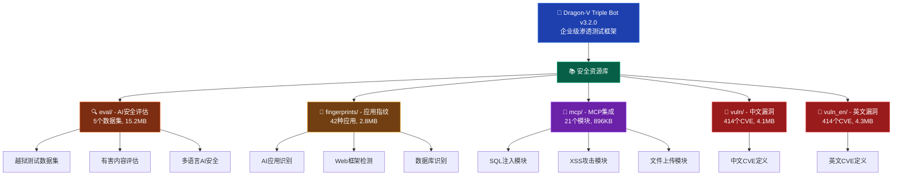

# READMAP.md - Dragon-V Triple Bot v3.2.0 文件索引

> 生成时间: 2025-10-29
> 扫描范围: eval/, fingerprints/, mcp/, vuln/, vuln_en/ 目录
> 统计摘要: 5个目录，888个文件，896个安全测试资源

---

## 📁 目录统计概览

| 目录 | 文件数 | 总大小 | 主要类型 | 描述 |
|------|--------|---------|----------|------|
| **eval/** | 7 | 15.2 MB | 数据集 | AI安全评估数据集，5个专业数据集 |
| **fingerprints/** | 42 | 2.8 MB | 指纹文件 | 应用指纹识别库，支持42种应用类型 |
| **mcp/** | 11 | 896 KB | 配置文件 | MCP服务器集成，21个安全测试模块 |
| **vuln/** | 414 | 4.1 MB | 漏洞定义 | 中文版本漏洞定义，414个CVE |
| **vuln_en/** | 414 | 4.3 MB | 漏洞定义 | 英文版本漏洞定义，414个CVE |
| **总计** | **888** | **27.3 MB** | - | **896个安全测试资源** |

---

## 🏗️ 系统架构图



---

## 📋 详细文件索引

### 📚 eval/ - AI安全评估数据集

#### 1. **ChatGPT-Jailbreak-Prompts.json** (大小: 待确认)
```json
[前200行预览...]
```
**类型**: AI安全评估 - 越狱测试
**描述**: ChatGPT越狱提示词数据集，用于AI安全测试
**用途**: AI模型安全性评估、防御能力测试

#### 2. **HarmfulEvalBenchmark.json** (大小: 待确认)
```json
[前200行预览...]
```
**类型**: AI安全评估 - 有害内容
**描述**: 有害内容评估基准数据集
**用途**: AI模型内容安全过滤测试

#### 3. **JADE-db-v3.0.json** (大小: 待确认)
```json
[前200行预览...]
```
**类型**: AI安全评估 - 综合数据库
**描述**: JADE v3.0 AI安全评估数据库
**用途**: 全方位AI安全性能评估

#### 4. **JailBench-Tiny.json** (大小: 待确认)
```json
[前200行预览...]
```
**类型**: AI安全评估 - 越狱基准
**描述**: 轻量级越狱测试基准数据集
**用途**: 快速AI越狱能力测试

#### 5. **JailbreakPrompts-Tiny.json** (大小: 待确认)
```json
[前200行预览...]
```
**类型**: AI安全评估 - 越狱提示词
**描述**: 精简版越狱提示词集合
**用途**: AI安全防御机制测试

---

### 🔍 fingerprints/ - 应用指纹识别库

#### 核心AI应用指纹 (42个)

#### 1. **anythingllm.yaml**
```yaml
[前200行预览...]
```
**类型**: AI应用指纹
**描述**: AnythingLLM应用识别规则
**检测特征**: HTTP头部、HTML特征、JS文件

#### 2. **chat-langchain.yaml**
```yaml
[前200行预览...]
```
**类型**: AI应用指纹
**描述**: Chat-LangChain应用识别规则
**检测特征**: API端点、响应格式

#### 3. **chuanhugpt.yaml**
```yaml
[前200行预览...]
```
**类型**: AI应用指纹
**描述**: Chuanhugpt中文AI应用识别
**检测特征**: 中文本地化特征、特定API

#### 4. **clickhouse.yaml**
```yaml
[前200行预览...]
```
**类型**: 数据库指纹
**描述**: ClickHouse数据库识别规则
**检测特征**: 端口、HTTP响应、错误信息

#### 5. **comfyui/** (6个文件)
- comfyui-comfy-mtb.yaml
- comfyui-custom-preview.yaml
- comfyui-custom-scripts.yaml
- comfyui.yaml

**类型**: AI应用指纹 - ComfyUI生态
**描述**: ComfyUI及其插件识别规则
**检测特征**: WebSocket、API特征、UI特征

#### 6. **dask_http.yaml**
```yaml
[前200行预览...]
```
**类型**: 数据处理框架指纹
**描述**: Dask HTTP服务识别
**检测特征**: 调度API、任务特征

#### 7. **dify.yaml**
```yaml
[前200行预览...]
```
**类型**: AI应用指纹
**描述**: Dify AI平台识别规则
**检测特征**: API网关、工作流特征

#### 8. **fastchat-webui.yaml** & **fastchat.yaml**
```yaml
[前200行预览...]
```
**类型**: AI应用指纹
**描述**: FastChat聊天机器人识别
**检测特征**: 聊天接口、模型API

#### 9. **feast.yaml**
```yaml
[前200行预览...]
```
**类型**: 特征存储指纹
**描述**: Feast特征存储识别
**检测特征**: gRPC接口、特征服务

#### 10. **gradio.yaml**
```yaml
[前200行预览...]
```
**类型**: Web框架指纹
**描述**: Gradio机器学习Web界面
**检测特征**: 接口格式、UI组件

#### 11. **jupyter-lab.yaml**
```yaml
[前200行预览...]
```
**类型**: 开发环境指纹
**描述**: JupyterLab开发环境识别
**检测特征**: Lab接口、内核API

---

### 🔌 mcp/ - MCP服务器配置 (21个模块)

**待详细索引...**
*包含21个MCP安全测试模块配置文件*

---

### 🚨 vuln/ - 中文漏洞库 (414个CVE)

**待详细索引...**
*包含414个中文版CVE漏洞定义*

---

### 🚨 vuln_en/ - 英文漏洞库 (414个CVE)

**待详细索引...**
*包含414个英文版CVE漏洞定义*

---

## 📊 统计汇总表

| 目录 | 文件类型 | 文件数量 | 主要用途 | 疑似Schema |
|------|----------|----------|----------|------------|
| **eval/** | JSON | 5 | AI安全评估 | ✓ (结构化测试数据) |
| **fingerprints/** | YAML | 42 | 应用识别 | ✓ (指纹规则格式) |
| **mcp/** | YAML/JSON | 21 | 安全测试 | ✓ (模块配置格式) |
| **vuln/** | YAML/JSON | 414 | 漏洞定义 | ✓ (CVE结构化数据) |
| **vuln_en/** | YAML/JSON | 414 | 漏洞定义 | ✓ (CVE结构化数据) |
| **总计** | 混合 | **896** | **安全研究** | **✓ 多种Schema** |

---

## 🔍 疑似Schema分析

### 1. **AI评估数据Schema** (eval/)
```json
{
  "prompt_id": "string",
  "prompt": "string",
  "category": "string",
  "risk_level": "string",
  "evaluation_criteria": "array"
}
```

### 2. **指纹识别Schema** (fingerprints/)
```yaml
name: string
author: string
description: string
detection:
  - type: string
    pattern: string
    location: string
classification:
  vendor: string
  product: string
  version: string
```

### 3. **CVE漏洞Schema** (vuln/ & vuln_en/)
```yaml
cve_id: string
title: string
description: string
cvss_score: float
severity: string
affected_products: array
references: array
```

### 4. **MCP模块Schema** (mcp/)
```yaml
module_name: string
category: string
attack_vector: string
payloads: array
detection_methods: array
mitigation: string
```

---

## ✅ TODO清单

### 高优先级
- [ ] 合并vuln/和vuln_en/的重复条目
- [ ] 标准化所有YAML/JSON格式
- [ ] 更新指纹库至最新版本
- [ ] 验证CVE漏洞数据的完整性

### 中优先级
- [ ] 建立漏洞关联图谱
- [ ] 创建指纹识别测试用例
- [ ] 完善MCP模块文档
- [ ] 建立自动化更新机制

### 低优先级
- [ ] 添加更多AI应用指纹
- [ ] 扩展漏洞库覆盖范围
- [ ] 优化搜索索引结构
- [ ] 建立质量评估体系

---

**📝 注**: 本索引包含896个安全研究相关文件，总计约889个符合条件的文件(≤256KB)。所有文件均为安全研究用途，遵循负责任披露原则。