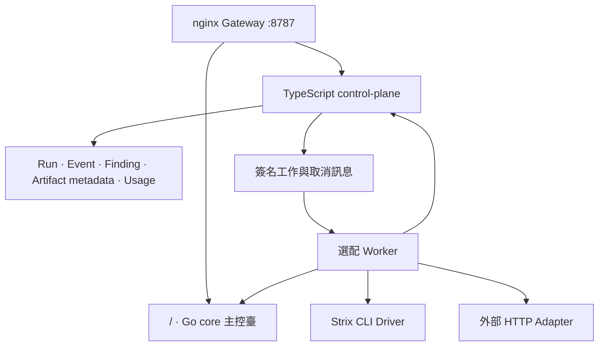
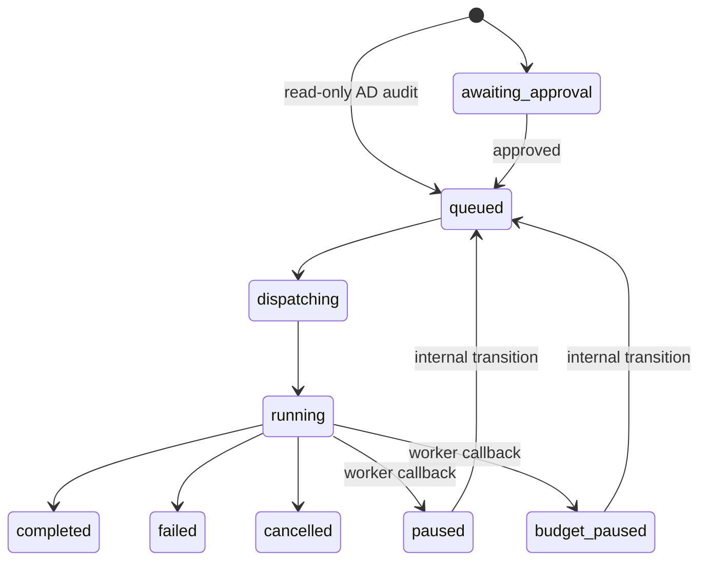

# JySecAI 系統架構與完成度

## 設計目標

JySecAI 把探索性安全 Agent 與確定性的治理控制面分離。引擎可以獨立演進，但 Scope、Run 狀態、證據索引與方案限制不應只存在於模型對話中。本檔案以 reference Compose 的實際整合狀態為準，並明列尚未完成的營運能力。

## 目前架構

- `compose.jysec.yml` 會同時啟動 PostgreSQL、Redis、以 `Dockerfile.core` 建置的 Go core、TypeScript control-plane 與 nginx Gateway；Worker 只在啟用 `worker` profile 時啟動。
- Go 主控臺與 TypeScript 治理頁已由 Gateway 整合成同一個對外入口，但仍是兩個程式與兩套身份，尚未實作 SSO。
- Strix Driver 存在於 Worker image；Jy Workflow Driver 會透過 Compose 私有網路呼叫 Go core，但仍需配置 service token。
- 其他引擎共用 HTTP Adapter client，但外部 Adapter service 本身不在本倉庫，也不會由 reference Compose 啟動。

## 統一入口（reference Compose 已實作）

同源 Gateway 的公開路徑固定為：

| 路徑 | 上游 | 用途 |
|---|---|---|
| `/`、`/static/*`、`/api/*` | Go core | 完整主控臺及既有 API |
| `/governance/`、`/assets/*`、`/v1/*`、`/metrics` | TypeScript control-plane | 治理頁、靜態資源、Run API 與 metrics |
| `/internal/*` | 不公開 | Worker 直接呼叫控制面 |

此路由設計保留既有 Go `/api/*` 與控制面 `/v1/*`，避免路徑碰撞。Gateway 的 `/healthz` 是路由層健康檢查；`/internal/*` 明確回傳 `404`，Worker 應直接使用私有 control-plane 位址。兩套身份的單一登入仍需共同 OIDC/JWKS 或受控 token exchange；單純放在同一網域不代表身份已整合。

## 已實作的核心不變數

1. 每個控制面 Run 只屬於一個 tenant 與 project。
2. 每個目標必須符合授權 tenant、project、期限、operation 與 target pattern。
3. 除 `ad-audit` 的唯讀 audit profile 外，主動工作會先進入 `awaiting_approval`。
4. 核准與 Worker dispatch 都會重新驗證授權期限與範圍。
5. 相同 idempotency key 只能代表相同請求；內容不同會回傳 `409 idempotency_conflict`。
6. Run 更新使用 expected status，避免取消與 Worker callback 互相覆寫。
7. Redis 工作使用 HMAC-SHA256 簽署並檢查發行時間。
8. Finding 需要 engine version、severity、confidence、status 與 fingerprint。
9. Artifact API 只接受安全相對 object key、SHA-256 與 `encrypted=true` metadata。
10. Production 啟動會拒絕 memory store、development auth、預設金鑰、未保護 metrics 與非 HTTPS 公開網址。

需要注意：目前的人工核准是單一狀態門，不是雙人覆核或簽章授權工作流；Worker callback 也仍共用 job-signing secret。更細緻的審批紀錄、服務身份與每工作 callback credential 屬於後續強化。

## Run 狀態

公開 API 目前提供 create、approve、list、get 與 cancel。`paused`／`budget_paused` 及回到 `queued` 的轉移存在於狀態模型，但尚無公開 pause/resume API、UI 或完整 checkpoint 恢復流程。

## 上下文與證據

| 層 | 目前狀態 | 儲存方式 |
|---|---|---|
| Go Agent Session／Project data | 已存在於 Go 核心 | 既有 SQLite 與檔案工作區 |
| Control-plane Run Events | 已實作 | PostgreSQL 追加序列 |
| Project Findings | 已實作正規化欄位 | PostgreSQL metadata |
| Artifacts | 僅 metadata 已實作 | object key、SHA-256、media type、size、encrypted flag |
| Artifact 本體 | 尚未完成 | S3／MinIO、KMS、presigned URL 尚待實作 |

`encrypted=true` 是 Adapter 宣告並由 schema 強制的 metadata，不會自行加密或上傳檔案。正式證據鏈仍需物件儲存、實際 checksum 驗證、下載授權與 retention job。

## 引擎接入層級

| 層級 | 引擎 | 說明 |
|---|---|---|
| Driver 已實作 | Strix | Worker 會啟動 CLI；仍需 LLM、Docker sandbox 與授權 target E2E |
| Driver 已實作、服務分離 | Jy Workflow／JySecAI | Compose 供應私有 Go core；仍須配置可用 service token |
| Adapter client only | Promptfoo、PyRIT、Giskard、ART、Humanbound、AD Audit | 本倉庫只有 `/v1/jobs/execute` client 與資料契約 |

Runtime catalog 會依明確啟用開關、service token 或 Adapter URL 判斷 `ready`／`unconfigured`，避免未配置引擎直接出現在建立任務選單。然而目前的 `ready` 是設定就緒，不是主動 liveness、版本、capacity 或 sandbox 健康證明。

## Queue 與恢復邊界

- Worker 透過 Redis consumer group 一次讀取一個工作並同步執行。
- 外層無法處理的訊息會寫入 bounded dead-letter stream。
- Driver 回傳格式錯誤時，目前會將 Run 標成 `failed` 後 ACK；不保證同時進入 dead-letter stream。
- 尚未實作 pending-entry reclaim、lease／heartbeat、分級 retry/backoff 或長任務 checkpoint。
- 方案的高並發數是 admission entitlement；實際吞吐仍取決於部署的 Worker 數量與 Adapter capacity。

## 尚未完成的正式營運能力

1. 對接共同 OIDC／SAML IdP、SCIM 與組織生命週期，消除兩套登入。
2. 實作 Worker registry、heartbeat、能力／版本探測、capacity 與引擎主動健康檢查。
3. 為每個外部引擎提供鎖定版本的 Adapter image、SBOM、簽章與授權 staging E2E。
4. 匯入 S3／MinIO envelope encryption、KMS rotation、checksum 驗證及下載授權 URL。
5. 加入 pending-job reclaim、retry/backoff、checkpoint、PostgreSQL／Redis HA、備份還原與災難復原演練。
6. 實作 credits settlement、retention scheduler、Enterprise license provisioning 與不可逆的 Stripe event ledger。
