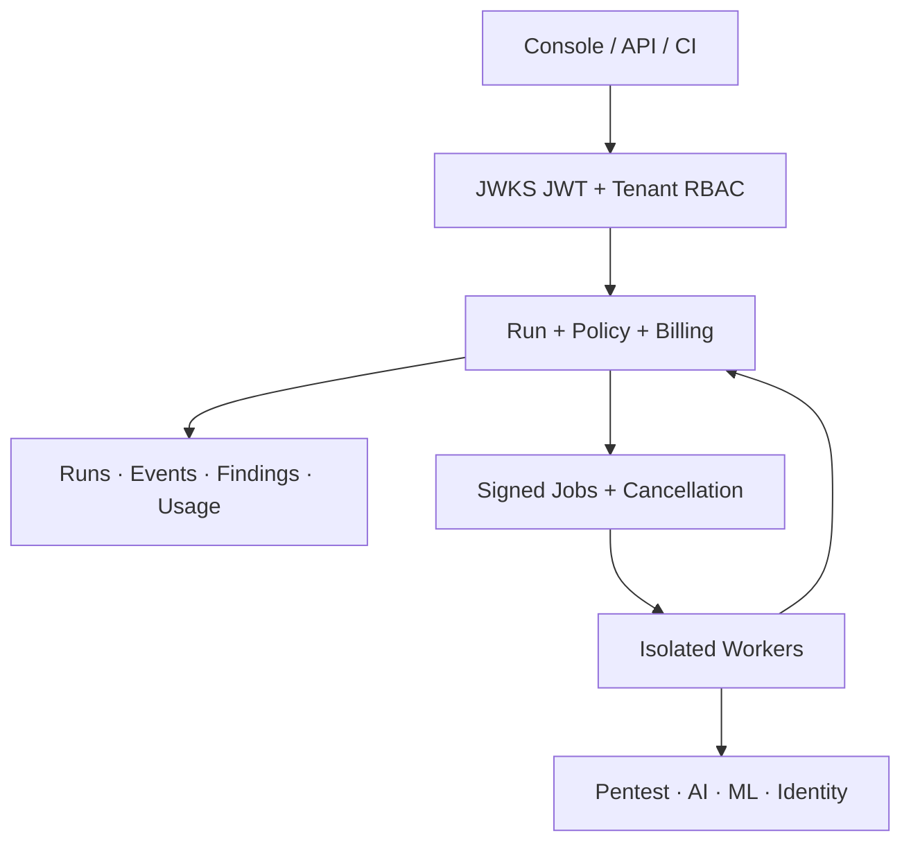
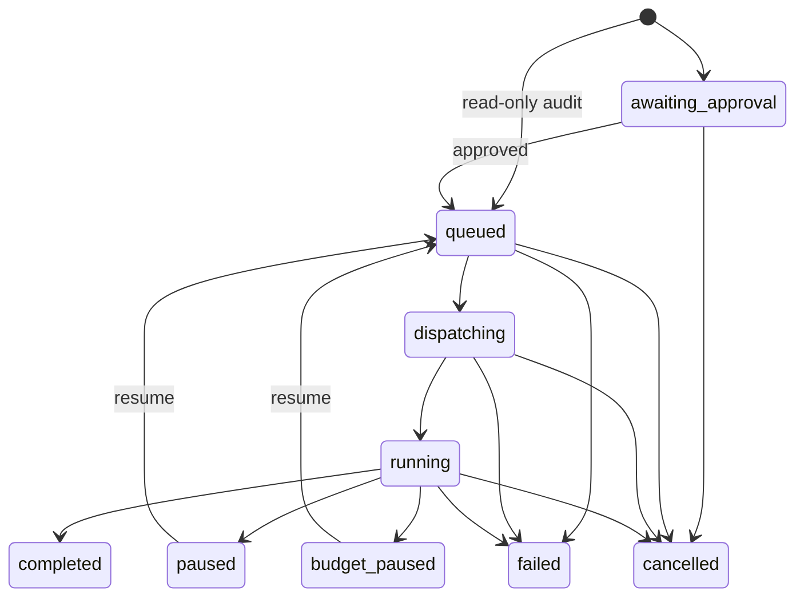

# JySecAI 系統架構

## 設計目標

JySecAI 把探索性安全 Agent 與企業治理控制面分離。引擎可以快速演進，但授權、狀態、證據、計費與稽核必須由確定性的 Runtime 管理，不能依賴模型自行描述。

## 核心不變量

1. 每個 Run 只屬於一個 tenant 與 project。
2. 每個目標必須同時符合授權 tenant、project、期限、operation 與 target pattern。
3. 除唯讀 AD audit profile 外，主動工作在 dispatch 前必須經具權限者核准。
4. 核准時與 Worker dispatch 時都重新驗證授權，避免排隊期間過期。
5. 相同 idempotency key 只能代表完全相同的請求；不同內容回傳 `409 idempotency_conflict`。
6. Run 狀態轉移使用 expected status，避免多 Worker 或取消競態覆寫終態。
7. Worker job 由 HMAC-SHA256 簽署並限制時間窗；失敗訊息進入 bounded dead-letter stream。
8. Finding 必須有 engine version、severity、confidence、status 與穩定 fingerprint。
9. Artifact 只接受安全相對 object key、SHA-256 與 `encrypted=true` metadata。
10. production 啟動時拒絕 memory store、dev auth、共用密鑰、未保護 metrics 與非 HTTPS 公開網址。

## 狀態機

終態為 `completed`、`failed`、`cancelled`。Worker 對相同終態 callback 採冪等處理，但不允許終態互相覆寫。

## 上下文與證據分層

| 層 | 內容 | 保存策略 |
|---|---|---|
| Agent Session | 當前推理、工具摘要、Mailbox | 短期、可壓縮 |
| Run Events | 狀態、進度、審批、重放序列 | 追加式稽核 |
| Project Findings | 正規化漏洞、信心、反證、修復 | 跨會話長期保存 |
| Artifacts | 原始 HTTP、報告、模型輸出、截圖 | 加密物件儲存＋SHA-256 |

大輸出不應整份塞回模型；Worker 應保留原始 Artifact，只將摘要與 reference 注入 Agent。

## 多引擎原則

- Control plane 不匯入引擎內部 Python／Go 相依，避免供應鏈與版本互相污染。
- 每個引擎在獨立 Worker 或 adapter service 執行。
- 統一 input 是簽名的 `SecurityRun`；統一 output 是 summary、findings、artifacts。
- GPU 型 ART／PyRIT Worker、Windows AD Worker 與 Docker Strix Worker 可各自水平擴展。
- 外部 adapter 只能回報當前 Run 的證據；tenant、project、engine 由控制面決定，不能由 adapter 冒名覆寫。

## 尚需在正式大規模營運前完成

- 對接實際 OIDC／SAML IdP（JWKS 驗證已支援）與 SCIM 使用者生命週期同步。
- 導入 S3／MinIO envelope encryption、KMS rotation 與下載授權 URL。
- 加入跨區 PostgreSQL、Redis HA、備份還原演練與災難復原目標。
- 對每個外部引擎建立鎖定版本、SBOM、簽章映像與隔離網路政策。
- 以真實 staging target 做完整 E2E；不得用未授權公開目標做驗收。
