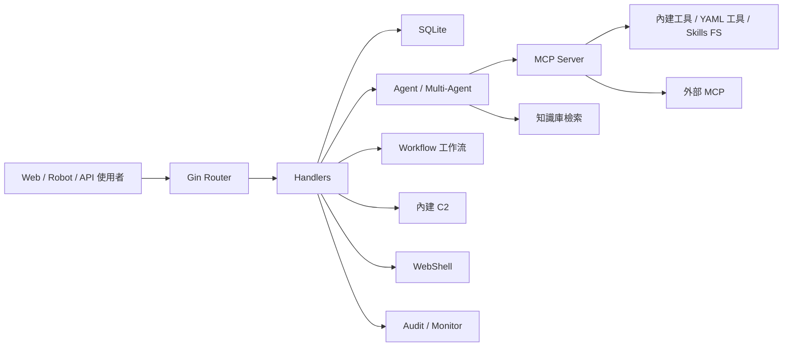

# 架構說明

JySecAI 是一個以 Web 管理面為入口、以 Agent 和 MCP 工具為執行核心的安全測試編排平臺。

## 總覽

## Web 層

入口在 `cmd/server/`，應用組裝在 `internal/app/`。Web 使用 Gin：

- `web/templates/index.html`：主頁面。
- `web/templates/api-docs.html`：API 文件頁面。
- `web/static/js/`：各業務模組前端邏輯。
- `web/static/css/`：樣式。

路由註冊集中在 `internal/app/app.go`。

## Handler 層

`internal/handler/` 按業務拆分：

- `agent.go`、`eino_single_agent.go`、`multi_agent.go`
- `workflow.go`、`workflow_run.go`
- `knowledge.go`
- `webshell.go`
- `c2.go`
- `audit.go`
- `monitor.go`
- `project.go`
- `vulnerability.go`
- `config.go`
- `openapi.go`

Handler 負責引數解析、許可權中介軟體後的業務協調和 HTTP 響應。

## Agent 層

單代理和多代理主要在：

- `internal/agent/`
- `internal/multiagent/`
- `internal/agents/`
- `agents/`

Eino ADK 提供單代理、Deep、Plan-Execute、Supervisor 等執行模式。多代理子 Agent 由 Markdown 檔案定義。

## MCP 與工具

MCP 相關：

- `internal/mcp/`：Server、外部 MCP、連線恢復。
- `internal/einomcp/`：Eino 與 MCP 工具適配。
- `tools/`：YAML 命令工具。
- `internal/app/*_tools.go`：Go 內建工具註冊。

工具呼叫會進入監控記錄，並可受 HITL 審批影響。

## Workflow

工作流引擎在 `internal/workflow/`，HTTP 入口在 `internal/handler/workflow*.go`。它支援 start、agent、tool、condition、hitl、output、end 等節點。

詳細使用見 [工作流使用說明](workflow-graph.md)。

## 知識庫

知識庫在 `internal/knowledge/`，包括：

- Markdown/文字內容管理。
- chunk。
- embedding。
- SQLite 向量索引。
- multi-query。
- rerank。
- 檢索日誌。

啟用後會向 Agent 暴露知識檢索工具。

## 資料層

`internal/database/` 封裝 SQLite 訪問，儲存：

- 對話、訊息、過程詳情。
- 分組。
- 工具執行記錄。
- HITL 日誌。
- 知識庫索引和檢索日誌。
- WebShell、C2、專案、漏洞、批次任務等業務資料。

預設資料庫檔案：

- `data/conversations.db`
- `data/knowledge.db`

## 安全與審計

`internal/security/` 提供認證、限流、Shell 執行和命令流處理。`internal/audit/` 和 `internal/monitor/` 分別負責平臺審計和執行監控。

高風險模組包括：

- Terminal。
- WebShell。
- C2。
- 外部 MCP。
- 檔案系統和 Shell Skills。

這些模組應結合角色、HITL 和部署隔離使用。

## 一次對話請求的真實路徑

以 `/api/eino-agent/stream` 為例：

1. Gin 路由進入認證中介軟體。
2. Handler 解析請求體、會話 ID、角色、附件和 WebShell 上下文。
3. Agent 構建模型輸入，包括歷史訊息、角色提示、專案事實、工具列表。
4. Eino Runner 呼叫模型。
5. 模型需要工具時走 MCP Tool。
6. 工具呼叫前可能觸發 HITL。
7. 工具執行結果寫入過程詳情和監控。
8. 模型繼續推理並生成最終回答。
9. SSE 將進度、工具事件、文字增量推給前端。
10. 會話、訊息、過程詳情寫入 SQLite。

這個路徑解釋了為什麼問題可能出在很多層：認證、會話、模型、工具、HITL、MCP、資料庫、SSE 或前端渲染。

## 橫向模組依賴

幾個模組不是獨立頁面，而是橫向能力：

- Project facts：會被注入 Agent 上下文，影響多輪和跨對話判斷。
- HITL：插在工具呼叫前，影響所有 Agent/MCP 工具。
- Monitor：記錄工具執行，影響任務取消、覆盤和通知。
- Audit：記錄平臺管理動作，影響安全運營。
- Tool search：影響模型看見哪些工具，而不僅僅是工具頁面顯示。

改這些模組時要看全域性呼叫點，不要只測單個頁面。

## 複雜度熱點

維護時優先警惕：

- `internal/app/app.go`：組裝所有服務，容易引入初始化順序問題。
- `internal/handler/config.go`：熱應用配置，影響模型、知識庫、C2、機器人和 MCP。
- `internal/multiagent/`：中介軟體多，流式、重試、摘要和工具呼叫交錯。
- `internal/security/`：Shell 和認證是安全邊界。
- `internal/database/`：SQLite 結構演進必須相容舊資料。

## 設計取捨

專案選擇單體 Go 服務 + SQLite + 靜態前端，是為了降低部署門檻。但代價是：

- 多例項橫向擴充套件不天然成立，尤其 SQLite 寫入和記憶體 session。
- 執行態配置和本地檔案強繫結，需要良好備份。
- 高許可權工具和 Web 管理面在同一程序內，部署隔離更重要。

這些不是缺陷，而是部署時必須理解的邊界。
