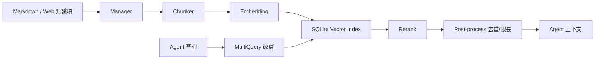

# 知識庫

知識庫用於把本地安全知識、漏洞手冊、測試方法和組織經驗轉成可檢索上下文，供 Agent 在任務中按需引用。

## 啟用

```yaml
knowledge:
  enabled: true
  base_path: knowledge_base
  embedding:
    provider: openai
    model: text-embedding-v4
    base_url: ""
    api_key: ""
database:
  knowledge_db_path: data/knowledge.db
```

`embedding.base_url/api_key` 留空時會複用 `openai` 配置。建議知識庫資料庫獨立儲存，便於遷移和複用。

## 內容目錄

預設目錄是 `knowledge_base/`。專案中已有示例：

```text
knowledge_base/
  SQL Injection/
    README.md
    MySQL Injection.md
  Prompt Injection/
    README.md
```

推薦用一級目錄表示風險型別或知識域，如：

- `SQL Injection`
- `XSS`
- `File Upload`
- `Cloud Security`
- `Incident Response`

## 管理流程

常見流程：

1. 把 Markdown 知識檔案放到 `knowledge_base/`。
2. 在 Web 知識庫頁面掃描目錄。
3. 重建索引。
4. 用搜尋功能驗證召回效果。
5. 在角色或任務中要求 Agent 優先查詢知識庫。

介面入口包括：

- `GET /api/knowledge/categories`
- `GET /api/knowledge/items`
- `POST /api/knowledge/scan`
- `POST /api/knowledge/index`
- `POST /api/knowledge/search`
- `GET /api/knowledge/index-status`
- `GET /api/knowledge/retrieval-logs`

## 索引

索引配置：

```yaml
knowledge:
  indexing:
    chunk_size: 512
    chunk_overlap: 50
    max_chunks_per_item: 0
    max_rpm: 0
    rate_limit_delay_ms: 300
    max_retries: 3
    retry_delay_ms: 1000
    chunk_strategy: markdown_then_recursive
    request_timeout_seconds: 120
    prefer_source_file: false
    batch_size: 10
    sub_indexes: []
```

建議：

- 文件結構清晰時用 `markdown_then_recursive`。
- 嵌入介面限制嚴格時降低 `batch_size`，增加 `rate_limit_delay_ms`。
- 單篇超長文件可設定 `max_chunks_per_item` 控制成本。
- 需要按業務域隔離時使用 `sub_indexes` 和 `sub_index_filter`。

## 檢索

```yaml
knowledge:
  retrieval:
    top_k: 5
    similarity_threshold: 0.4
    multi_query:
      max_queries: 4
    post_retrieve:
      prefetch_top_k: 20
      max_context_chars: 0
      max_context_tokens: 0
```

檢索鏈路大致為：

1. 使用者查詢或 Agent 查詢。
2. MultiQuery 改寫出多個語義變體。
3. 向量檢索獲取候選塊。
4. rerank 精排。
5. 後處理去重、限長。
6. 返回給 Agent 或 API 呼叫方。

`similarity_threshold` 太高會漏召回，太低會帶入噪聲。初始建議 0.35 到 0.45。

## Rerank

```yaml
knowledge:
  retrieval:
    rerank:
      provider: ""
      model: ""
      base_url: ""
      api_key: ""
```

留空時會根據 `base_url` 推斷。DashScope 常用 `gte-rerank`；其他 OpenAI 相容端點可能走 `/v1/rerank`。如果服務商不支援 rerank，檢索質量可能下降，建議降低 `top_k` 並提高知識條目質量。

## MCP 工具

啟用知識庫後，會註冊類似以下能力：

- 列出風險型別。
- 搜尋知識庫。
- 獲取相關知識片段。

角色提示詞中可以寫明：

```text
遇到漏洞驗證、修復建議或檢測方法不確定時，先檢索知識庫，再給出結論。
```

## 內容編寫建議

每篇知識建議包含：

- 適用場景。
- 檢測方法。
- 驗證步驟。
- 常見誤報。
- 修復建議。
- 工具命令示例。
- 參考連結或內部標準。

避免把無關主題堆在同一篇長文中。小而清晰的文件更利於 chunk 和召回。

## 排錯

索引失敗：

- 檢查 embedding API Key、模型名、base_url。
- 降低 `batch_size`。
- 增大 `request_timeout_seconds`。
- 檢視服務日誌中的 400/401/429/5xx。

檢索為空：

- 檢查是否已重建索引。
- 降低 `similarity_threshold`。
- 檢視 `categories` 是否識別到風險型別。
- 搜尋時不要使用過窄的 `riskType`。

召回不準：

- 最佳化標題層級。
- 把混雜內容拆成多篇。
- 增加關鍵術語和同義詞。
- 調整 `top_k`、`prefetch_top_k` 和 rerank 配置。

## 內部資料流

知識庫鏈路不是“全文搜尋”，而是一個多階段檢索系統：



因此檢索質量取決於四件事：原文結構、chunk 粒度、embedding 質量、rerank 可用性。單純調 `top_k` 往往不是最有效的辦法。

## 知識項寫作反例

不好的知識：

```text
SQL隱碼攻擊很危險，可以用sqlmap掃，修復就是過濾。
```

好的知識：

```markdown
# MySQL UNION 注入驗證

## 觸發條件
- 引數進入 SELECT 查詢並直接拼接。
- 頁面返回欄位數量錯誤或型別錯誤。

## 驗證步驟
1. 使用 `' order by 1-- -` 遞增列數。
2. 使用 `union select null,...` 校驗回顯位。
3. 用只讀函式確認資料庫型別，例如 `database()`。

## 誤報排除
- WAF 注入攔截頁可能模擬 SQL 錯誤。
- 統一錯誤頁不能直接證明注入。

## 修復
- 引數化查詢。
- 最小資料庫許可權。
- 統一錯誤處理但不吞掉安全日誌。
```

第二種寫法能給 chunk 足夠的標題、術語和步驟訊號，Agent 也能直接執行。

## 調參方法

先固定一組測試問題，例如：

```text
MySQL union 注入怎麼判斷欄位數？
SSRF 如何驗證雲後設資料訪問？
檔案上傳黑名單繞過有哪些誤報？
```

然後逐項調：

1. 搜尋為空：降低 `similarity_threshold`，確認索引完成。
2. 結果主題錯：提高文件標題質量，增加風險型別過濾。
3. 結果片段斷裂：增大 `chunk_overlap` 或降低 `chunk_size` 後重建索引。
4. 噪聲多：提高 `similarity_threshold`，啟用/修復 rerank。
5. 成本高：降低 `multi_query.max_queries`、`prefetch_top_k`、`top_k`。

每次只改一個引數，並記錄查詢結果，否則無法判斷哪個變數有效。

## 檢索日誌怎麼用

檢索日誌不只是排錯用，還可以反向改進知識庫：

- 高頻無結果查詢：說明缺知識或同義詞不足。
- 高頻低分查詢：說明文件標題和術語不匹配。
- 同一問題召回多個重複文件：說明需要合併或加 category。
- Agent 常忽略知識庫結果：說明結果太長、太散或缺明確結論。

## 原始碼錨點

- 知識管理：`internal/knowledge/manager.go`
- 索引流水線：`internal/knowledge/index_pipeline.go`
- Eino chunk：`internal/knowledge/chunk_eino.go`
- 檢索器：`internal/knowledge/retriever.go`
- Eino 檢索鏈：`internal/knowledge/eino_retrieve_chain.go`
- rerank：`internal/knowledge/rerank_http.go`
- MCP 工具：`internal/knowledge/tool.go`
